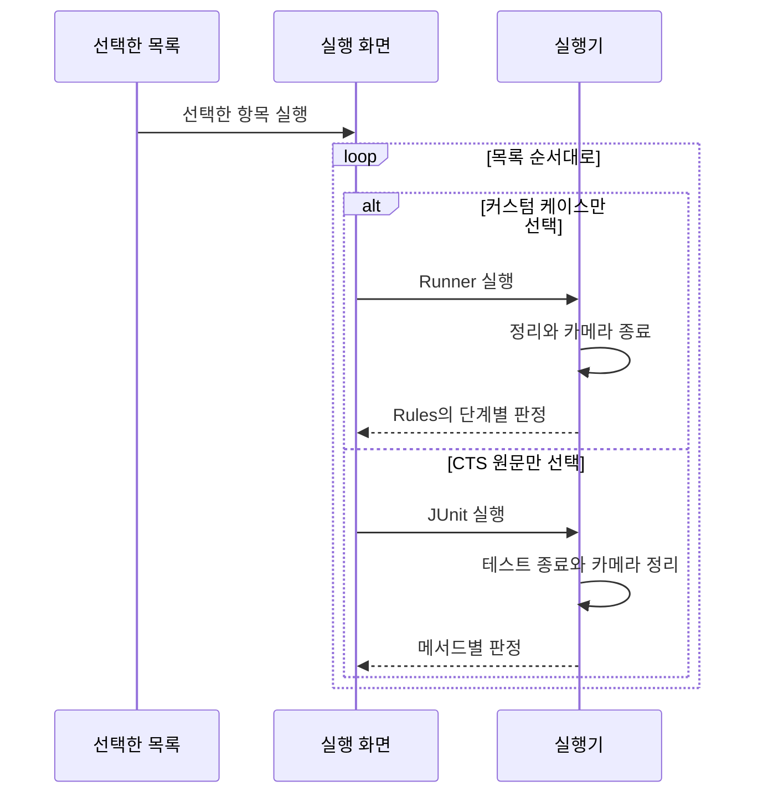

# CTS 구현과 확장 참고

사용자 가이드에서 분리한 개발자용 자료입니다. 앱 사용 절차는 [CTS](../../guide/cts.md)에 있습니다.

단일 항목 실행과 내부 처리

단일 항목은 커스텀 케이스의 `CtsCaseActivity` 또는 CTS 원문의 `VendoredCaseActivity`에서 실행합니다. `Run`·`Stop`·`Copy`·`Share`는 목록 실행과 같은 방식으로 조작하며, 결과는 해당 항목만 표시합니다.

커스텀 케이스는 한 단계가 실패해도 나머지 단계와 카메라를 계속 실행합니다. 화면의 SurfaceView가 CTS의 `Camera2SurfaceViewCtsActivity` 역할을 하며, 러너가 필요한 크기로 버퍼를 바꾸고 `surfaceChanged`를 기다린 뒤 세션을 엽니다. 카메라 열기·세션 구성·첫 결과·닫기의 대기 시간은 CTS `CameraTestUtils`와 같은 3초입니다.

CTS 원문 케이스의 한 번 실행은 다릅니다. `Run`을 누르면 카메라와 마이크 권한을 확인한 뒤 JUnit이 테스트 메서드를 작업 스레드에서 돌립니다. 테스트는 카메라 전부를 스스로 순회하므로 진행 중에는 경과 시간만 갱신되고, 실패가 생기면 그 즉시 실패 카드가 추가됩니다. `Stop`은 실행 중인 테스트가 쥔 카메라를 닫아 테스트를 실패시키는 방식이라 몇 초 뒤에 `중단됨`으로 끝납니다. JUnit에는 실행 중인 본문을 멈출 수단이 없기 때문입니다. 실행 화면 자체가 CTS의 `Camera2SurfaceViewCtsActivity`를 상속하므로 테스트의 `updatePreviewSurface`가 같은 SurfaceView를 그대로 씁니다.

검사 실행 구조

한 번의 실행에는 한 종류만 들어갑니다. 취소하면 남은 항목은 실행하지 않으며, 다음 케이스는 현재 케이스의 정리가 끝난 뒤 시작합니다.

두 목록은 모두 체크리스트이고, 체크한 항목을 `Run Selected`로 실행하면 `CtsSuiteRunActivity`가 위에서부터 차례로 돌립니다.

실행 화면은 `Camera2SurfaceViewCtsActivity`를 상속하고 커스텀 러너의 `PreviewHost`를 구현해 SurfaceView를 공유합니다.

커스텀 케이스의 규칙은 카메라를 모르는 순수 Kotlin이라 JVM 테스트로 검증하고, 러너가 CTS가 기기에서 읽는 값을 채워 넣습니다.

다섯 케이스는 같은 `CtsRunner` 계약을 구현하므로 화면은 케이스를 구분하지 않습니다.

CTS 원문 케이스는 코드를 옮기지 않으므로 검사 본문은 AOSP 소스를 따르며, 앱 실행에 필요한 instrumentation 대역과 공개 API 호환 패치를 적용합니다.

원문 출처와 앱 실행을 위한 변경

목록은 `:ctsvendor` 모듈에 가져온 클래스의 `@Test` 메서드를 reflection으로 나열합니다. 소스는 AOSP `android16-release`의 `cts/tests/camera`와 `frameworks/ex/camera2/public`입니다. 원본 커밋과 적용한 패치 여덟 건(`@TestApi`·`@FlaggedApi` 호출 변경과 shell 권한 행 제거)은 `ctsvendor/UPSTREAM.md`에 있습니다. 업스트림의 `min_sdk_version 34`에 따라 Android 14 아래에서는 이 경로가 비활성화됩니다.

개발자용: 커스텀·AOSP 케이스 추가 절차

커스텀 케이스를 추가하려면 다음 순서를 따릅니다.

1. 케이스별 하위 패키지(`cts/onoff/`처럼)에 판정을 담은 순수 Kotlin `…Rules`와 카메라를 다루는 `…Runner`를 둡니다. 러너는 `CameraCaseRunner`를 상속해 `runCamera`(카메라마다) 또는 `runCameras`(카메라를 섞어 쓰는 경우)를 구현합니다.
2. 열기 → 프리뷰 → 첫 프레임 → 닫기가 필요하면 `openCycle`과 `OpenCycle`을, 녹화가 필요하면 `CamcorderRecording`을, 정지 영상이 필요하면 `JpegReader`와 `Camera2Ops.captureStill`을 재사용합니다.
3. `CtsCatalog`에 id·원본·제목·요약을, `CtsRunners`에 러너 생성을 등록합니다. 규칙의 JVM 테스트를 함께 씁니다.

CTS 원문 클래스를 추가하려면 테스트마다 코드를 쓰지 않습니다.

1. AOSP 같은 브랜치에서 테스트 클래스 파일을 `ctsvendor/src/main/java/`의 같은 패키지 경로에 복사합니다. `Camera2SurfaceViewTestCase`나 `Camera2AndroidTestRule` 계열이 아니면 그 기반 클래스도 함께 가져옵니다.
2. `./gradlew :ctsvendor:compileDebugJavaWithJavac`로 컴파일합니다. 오류가 난 호출이 곧 `@TestApi`·`@FlaggedApi` 목록이므로, `UPSTREAM.md`의 패치처럼 공개 API로 바꾸거나 그 메서드를 제거하고 패치 목록에 적습니다.
3. `VendoredCatalog.classes`에 클래스를 넣습니다. `@Test` 메서드는 reflection으로 나열되므로 목록은 자동으로 늘어납니다.

