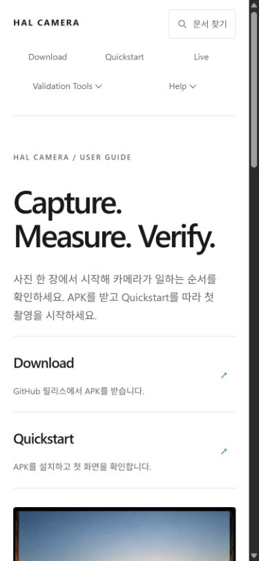
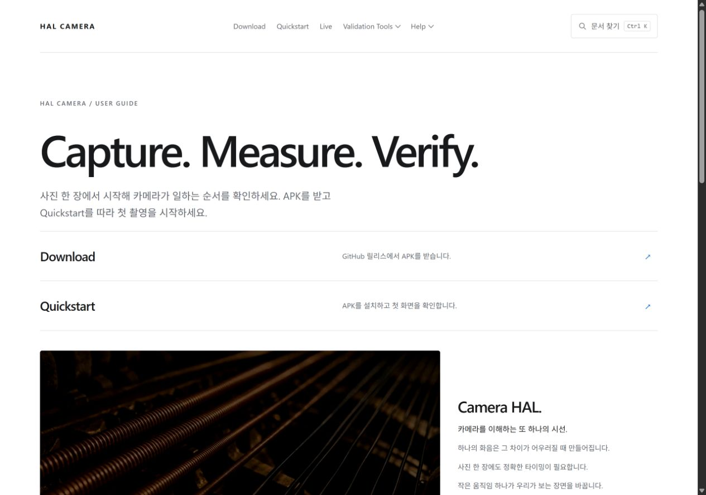

# 문서·홈 UX 수정 검증 — 2026-10-17

## 범위

현재 지표 계약과 과거 초안을 분리하고, 실행 이력 기본 필터·점수 문서 링크·APK와 스킬의 버전 안내를 바로잡았습니다. 홈의 Download와 Quickstart를 영상 위로 옮기고, 동작 줄이기 설정에서 자동 재생을 차단했습니다. 앱의 카메라 구현은 변경하지 않았습니다.

## 확인 결과

- `docflow.mjs check --build`: 6단계 통과. `site check`: 생성물 일치.
- `npm test --prefix tools/docgen`: 37개 통과. 링크·검색·문서 파이프라인·영상 정책 회귀 검사 포함.
- IAB 브라우저 viewport 320×844, 390×844, 430×932, 1280×900에서 가로 넘침 없음.
- 홈의 두 진입 링크가 모두 영상보다 앞에 있으며, 위 네 viewport의 첫 화면 안에 표시됨. 390px에서 링크 높이는 각각 약 114px이고 Quickstart의 하단은 약 735px.
- 홈의 Download와 Quickstart를 눌러 해당 페이지로 이동하는 동작 확인.
- 동작 줄이기 켜짐, 재생 중 설정 변경, 자동 재생 거절과 음소거 재시도, 재시도 전 설정 변경을 Node의 video/media-query 대역으로 검증. 브라우저 도구가 OS 동작 줄이기 설정의 에뮬레이션을 제공하지 않으므로 실제 OS 설정 전환은 검증하지 않음.
- 모바일 검증은 브라우저 viewport 검사이며 물리 Android 기기의 카메라 실측이 아님.

