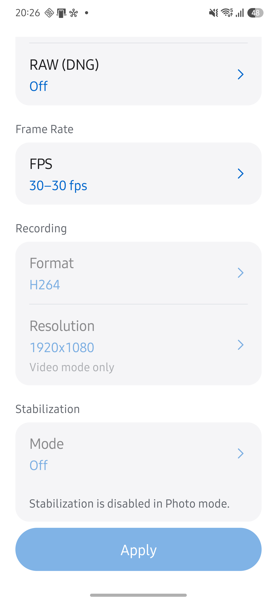
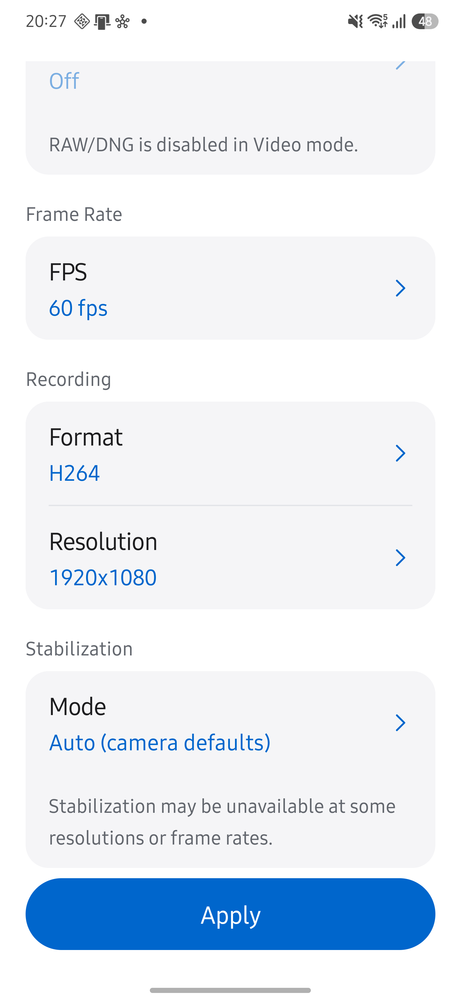
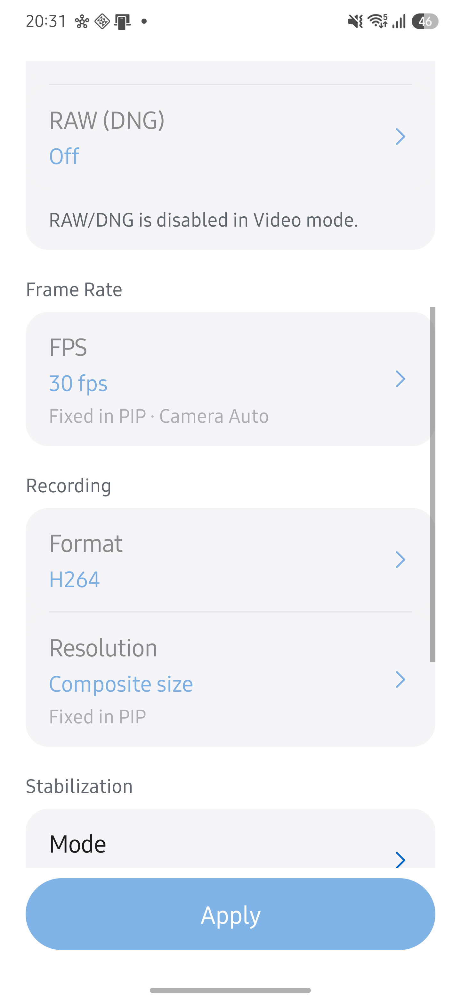

# Live FPS·Callback 기기 검증

**Galaxy S25+에서 FPS 통합 설정과 Service ID별 Callback 전환을 확인했습니다.**

- 검증일: 2026-10-11 (KST).
- 기기: Samsung SM-S936N, Android 16, QTI SM8750.
- APK: 0.24.0, 코드 `9c134d17`. 동일 서명의 release APK를 기존 앱에 업데이트했습니다.
- 도구: 무선 ADB, Android CLI UI 조회, MediaStore 목록, 로컬 화면 녹화와 프레임 추출.

## 기기 관찰

| 조건 | 결과 |
| --- | --- |
| Camera2 PHOTO | FPS 한 항목에서 Auto와 지원 범위를 선택했습니다. 30–30fps 적용 후 Live에서 약 29.8fps를 관측했습니다. Format을 눌러도 녹화 설정 선택창이 열리지 않았습니다. |
| Camera2 VIDEO | FPS 목록에 60·30·24fps가 표시됐습니다. 포맷을 HEVC, 해상도를 1280×720로 바꾼 뒤 같은 FPS 항목에서 60fps를 적용했고 Live에서 60.0fps를 관측했습니다. |
| Camera2 VIDEO, Service 0+1 PIP | FPS가 `30 fps`, `Fixed in PIP · Camera Auto`로 표시됐습니다. FPS를 눌러도 선택창이 열리지 않았습니다. |
| CameraX PHOTO, Service 0+1 PIP | FPS가 `Auto`, `Auto in PIP`로 표시됐습니다. FPS를 눌러도 선택창이 열리지 않았습니다. |
| Camera2 PIP Callback | `ID 0 ↻`와 `Hold 10s ↻`의 테두리와 버튼 영역을 확인했습니다. ID 0에는 YUV를 포함한 다섯 행, ID 1에는 YUV 없는 네 행과 독립 프레임 번호가 표시됐습니다. Hold에서 0·1·3·5·10초를 모두 확인했습니다. |
| Camera2 Callback 연속 전환 | 약 4초의 로컬 녹화 중 ID를 다섯 번 전환했습니다. 추출한 전환 중 프레임에서 누름 효과, 밝기 변화, 높이 변화를 확인했으며 빈 그래프 대신 선택한 ID의 값이 표시됐습니다. 전환 후 밝기와 전체 행이 복구됐습니다. |
| CameraX PIP Callback 촬영·전환 | Hold 10초에서 촬영한 ID 0의 Frame 540이 JPEG 도착 값과 함께 고정됐습니다. ID 1로 바꾸면 고정 표시 없이 최신 Frame 640이 표시됐습니다. 시간을 0초로 변경할 수 있었습니다. |
| CameraX PIP JPEG 촬영 | 새 원본 JPEG 두 장은 각각 1920×1080, 합성 JPEG는 590×1280이었습니다. 새 파일은 총 세 장이며 합성 저장 이벤트는 Callback 행에 추가되지 않았습니다. |

검증 후 기기는 Camera2 PHOTO, Service 0+1 PIP, Callback ID 0, Hold 0초 상태로 두었습니다. 마지막 앱 로그 조회에서 FATAL EXCEPTION이나 앱 ANR은 발견하지 않았습니다.

## 설정 화면

아래 설정 화면에는 카메라 영상과 갤러리 썸네일이 없습니다. Callback 스크린샷과 화면 녹화는 로컬에만 보관했습니다.

## 코드 검증과 범위

서명 release 빌드, JVM 테스트 784개, Android lint, 문서 회귀 테스트 33개와 문서 검사 7단계가 통과했습니다. 독립 모델 리뷰에서 수정할 회귀는 발견되지 않았습니다.

이 검증은 설정 적용·프리뷰·Callback 전환과 한 번의 PIP 사진 촬영을 확인한 결과입니다. 녹화 파일의 프레임률, Exynos·다른 기기의 HAL 동작, 큰 글꼴·자연 가로 방향 화면은 이번 기기 검증에 포함하지 않았습니다. PIP 사전 검사와 이전 촬영 경로의 검증은 [PIP 기기 검증](pip-availability-2026-10-11.md)에서 확인하세요.
