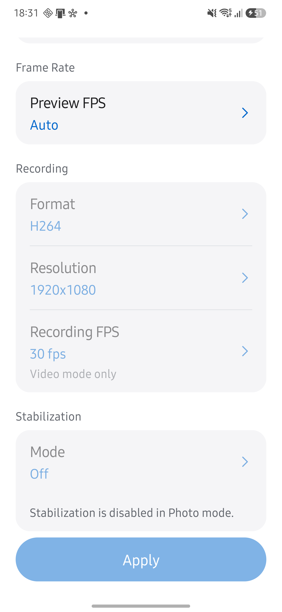
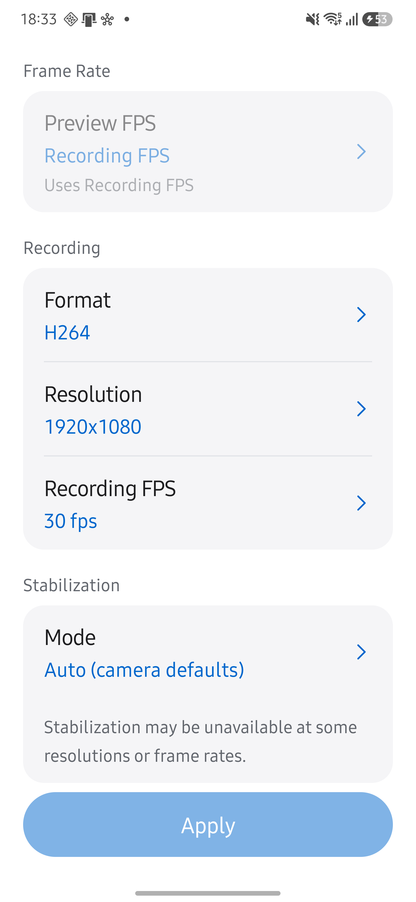
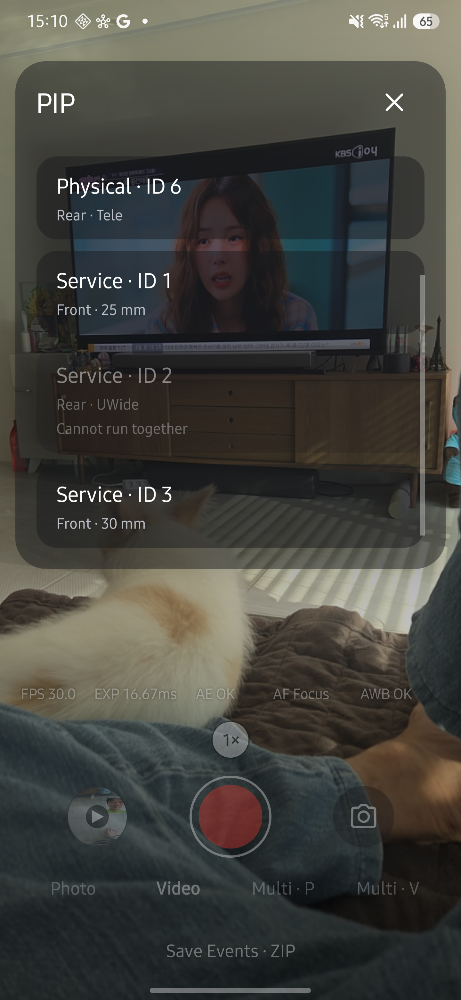
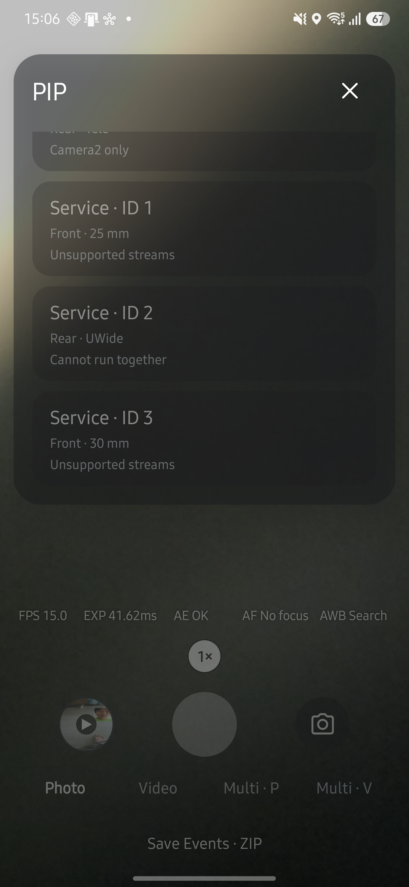

# PIP 선택 사전 검사 기기 검증

**Galaxy S25+에서 지원 불가 항목의 선택 차단과 지원되는 PIP 프리뷰 구성을 확인했습니다.** 기기별 예외는 추가하지 않았습니다.

- 검증일: 2026-10-11 (KST).
- 기기: Samsung SM-S936N, Android 16, QTI SM8750.
- APK: 0.24.0, 변경 코드 `44517453`, 기존 앱과 같은 서명의 release 빌드로 업데이트했습니다.
- 도구: 무선 ADB, Android CLI의 UI 조회, HAL CAM CLI의 `live info`.

## 확인한 결과

| 조건 | 관찰 결과 |
| --- | --- |
| Camera2 VIDEO, 메인 Service 0 + Service 2 | 후보가 `Cannot run together`로 표시됐습니다. 탭해도 선택창이 유지됐고 해당 조합은 적용되지 않았습니다. |
| Camera2 VIDEO, 메인 Service 0 + Physical 2 | 선택이 허용됐습니다. PIP 선택 표시와 합성 TextureView가 나타났으며 VIDEO 모드가 유지됐습니다. `live info`의 `ready`가 true였고 프리뷰 1280×720, YUV 640×480, 합성 JPEG 590×1280을 확인했습니다. 화면 FPS는 약 30이었습니다. |
| Camera2 PHOTO, 메인 Service 0 + Physical 2 | PIP 선택 표시와 합성 프리뷰가 나타났으며 `ready`가 true였습니다. |
| CameraX PHOTO, 분석 3840×2160 | Service 1·3이 `Unsupported streams`로 표시됐습니다. Service 1을 탭해도 적용되지 않았습니다. Service 2는 `Cannot run together`, Physical 후보는 `Camera2 only`로 표시됐습니다. |
| CameraX PHOTO, 분석을 640×480으로 변경한 뒤 Service 1 선택 | Service 1·3이 다시 선택 가능해졌습니다. Service 1의 PIP 구성이 완료됐고 선택창을 다시 열어 선택 표시를 확인했습니다. `ready`가 true였으며 메인·보조 프리뷰는 각각 1280×720, 분석은 640×480이었습니다. |

이 기록은 선택 사전 검사와 프리뷰 구성의 검증입니다. 녹화·사진 파일 저장, Exynos를 포함한 다른 기기의 HAL 동작, 조회 API 미지원 기기의 실제 구성은 별도 검증이 필요합니다. 조회 불가 시 선택을 허용하는 분기와 작은 지원 프리뷰를 유지하는 규칙은 JVM 테스트로 확인했습니다.

## 후속 촬영·Live Streams 검증

같은 기기에 최종 Live 표시 변경을 포함한 서명 APK를 설치하여 아래 결과를 확인했습니다. 모드·크기·콜백 ID는 Android CLI UI 조회와 로컬 스크린샷으로, 저장 파일 수와 해상도는 HALCamera의 MediaStore 목록으로 확인했습니다. 카메라 픽셀이 있는 후속 검증 이미지는 저장소에 게시하지 않았습니다.

| 조건 | 관찰 결과 |
| --- | --- |
| Camera2 Service 0 + Service 1, 카메라 JPEG On | 합성 JPEG 590×1280과 원본 JPEG 두 장이 저장됐습니다. 기본 원본은 각각 1920×1080이었습니다. |
| 같은 조합의 PIP Preview 640×480, Photo 1280×720 | Live에 `PIP P 640×480 J 1280×720`이 표시됐으며 보조 원본 파일도 1280×720이었습니다. 메인 원본은 1920×1080으로 유지됐습니다. |
| JPEG Off, RAW Off | PIP 셔터가 활성화됐고 합성 JPEG 한 장만 추가됐습니다. ID 0·1 양쪽 Callback 그래프에 JPEG 행이 없었습니다. |
| Callback ID 전환 | ID 0과 ID 1을 각각 선택할 수 있었으며 독립 프레임 번호와 프리뷰 관측을 표시했습니다. 합성 저장을 카메라 JPEG 행으로 표시하지 않았습니다. |
| Camera2 Service 1, JPEG 출처 YUV 640×480 | 회전하여 저장한 두 원본 JPEG는 각각 480×640, 합성 JPEG는 590×1280이었습니다. 총 세 장이 추가됐습니다. |
| Camera2 Physical 2, JPEG Off | Physical 프리뷰 구성이 완료됐고 합성 한 장을 저장했습니다. |
| Camera2 Physical 2, JPEG 출처 YUV 640×480 | Physical 원본과 메인 원본을 각각 480×640 JPEG로 저장하고 합성 한 장을 추가했습니다. |
| CameraX Service 0 + Service 1, 기본 카메라 JPEG | 두 원본 1920×1080과 합성 590×1280을 저장했습니다. PIP의 기본 분석 출력은 Off였습니다. |
| PHOTO Live Streams | Format·Resolution·Recording FPS와 Stabilization이 비활성화됐습니다. Format을 탭해도 선택창이 열리지 않았고 초기 Apply는 비활성화됐습니다. |
| VIDEO Live Streams | Preview FPS는 Recording FPS를 사용하도록 비활성화됐습니다. Recording FPS 선택창에는 60·30·24fps 후보가 표시됐고 RAW는 비활성화됐습니다. |
| Multi Streams | 카메라 0·1의 Active 1280×720 상태를 화면 안에서 읽기 전용으로 표시했습니다. 최대 카메라 수 선택은 없었습니다. |
| Live 크기 표시 | PIP를 한 번만 쓰고 P·Y·J를 나열했습니다. 합성 크기와 C 표시는 없었습니다. |

Physical의 네이티브 JPEG 두 장 경로, CameraX의 YUV 출처 세 장 저장, 녹화 파일 저장과 자연 가로 방향 기기의 회전은 이번 후속 하드웨어 검증에 포함하지 않았습니다. 추가 검증 중 무선 연결이 다시 오프라인으로 바뀌었습니다. Exynos를 포함한 다른 기기의 HAL 동작은 확인하지 않았습니다.

### Live Streams 화면

아래 설정 화면에는 카메라 배경이나 갤러리 썸네일이 없습니다.

## 기존 PIP 선택 화면

Android CLI로 설정창의 후보·사유·선택 상태를 확인했습니다. `Cannot run together`, `Unsupported streams`, `Camera2 only`를 확인했으며, 차단 항목을 탭한 뒤에도 선택창이 유지됐습니다.

사용자가 게시를 승인한 기기 스크린샷입니다.

## 코드 검증

후속 원본 사진 저장·PIP 크기 설정과 Live Streams 모드 점검을 포함하여 앱 JVM 테스트 784개, Android lint, 서명 release APK 빌드가 통과했습니다. 독립 코드 리뷰에서 발견한 CameraX 단일·동시 모드 판정, Camera2 종료 중 촬영 대기, 보조 사진의 화면 회전 처리 문제를 수정했습니다. Physical 원본도 별도 요청에 해당 센서의 방향을 적용하며 이 수정의 재리뷰에서 추가 문제는 발견되지 않았습니다.

첫 기기 표는 `44517453`의 사전 검사 결과이며 후속 촬영·UI 검증은 별도 표에 기록했습니다. 다른 기기와 자연 가로 방향 기기의 회전 처리는 이 기록의 하드웨어 검증 범위에 포함하지 않습니다.

Live Streams는 PHOTO의 녹화 항목, VIDEO의 별도 Preview FPS, 고정 PIP 녹화 값의 선택을 막습니다. 최대 카메라 수 항목과 이전 상한 적용을 제거했습니다. 모델 리뷰에서 지적한 미광고 `[30,30]` PIP 요청을 제거하여 카메라는 Auto, 합성 인코더는 30fps를 사용합니다. 모드 점검의 재리뷰에서는 추가 코드 문제가 발견되지 않았습니다. Live 라벨 변경 리뷰에서 지적한 stale 검토 기록과 사이트 산출물은 갱신하여 문서 검사로 확인합니다.

문서 변경은 사용자가 승인했으며 승인 기록 작성도 위임했습니다. 문서 검증기의 reviewer는 `TTolsun (approval delegated to Codex)`로 기록했습니다.

사용 방법은 [Live PIP 가이드](../../guide/live.md#pip로-보이는-구도를-저장하세요)에서 확인합니다.
