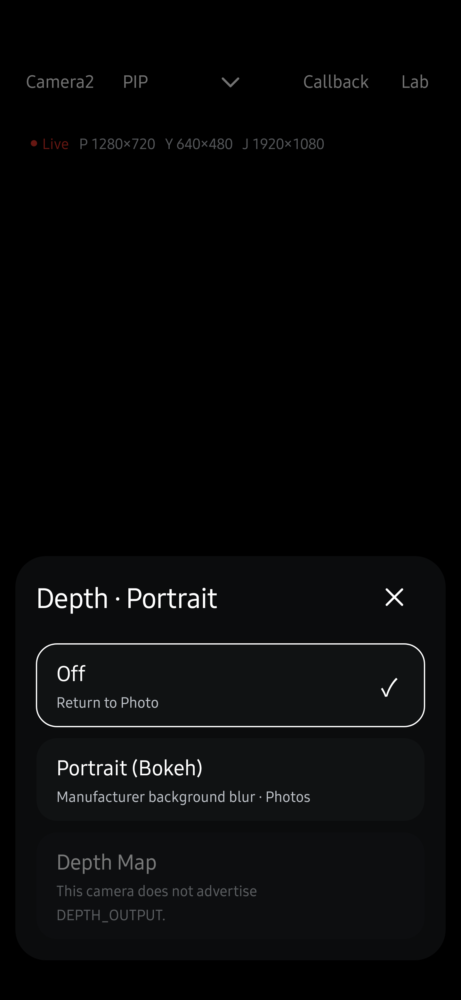
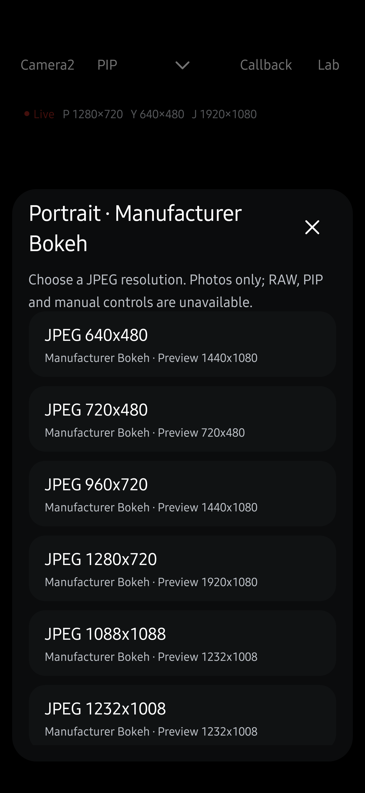
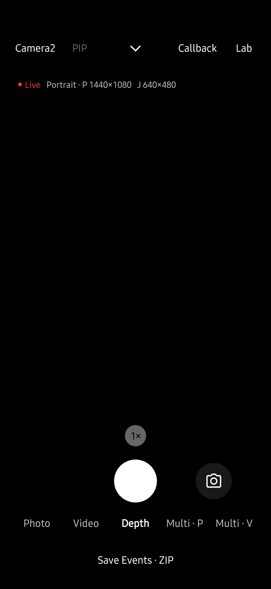

# 제조사 Bokeh Portrait 검증

2026-10-20에 Samsung SM-S936N, Android 16 / API 36에서 제조사 BOKEH 확장 조회와 촬영을 검증했습니다. 앱 0.30.0(691)을 서명이 일치하는 빌드로 갱신했으며 기존 앱 데이터를 삭제하지 않았습니다.

## 확인한 동작

PROBE는 공개 카메라 0·1·2·3에서 BOKEH 지원과 확장 전용 미리보기·JPEG 크기를 보고했습니다. 물리 카메라 5·6은 독립적으로 선택할 수 없다는 이유를 표시했습니다. [PROBE 발췌](probe-summary.json)에 각 카메라의 전체 크기 목록이 있습니다.

PROBE 요청 `dd81ce3e-9c78-4537-a7f6-f8034c9a06b7`는 오류 없이 완료됐습니다. 원본 JSON 371,945바이트와 TXT 264,439바이트를 PC로 수집하고 manifest 해시와 대조했습니다. SHA-256은 JSON `9d325cc099c776e4a3aea92bdd7865ce9cc5baee5e25fe3d875411b13835c137`, TXT `1acc4521cca0a0c4fad46e41dd591b440bf2c943b1de14da52732c758edc8757`입니다.

최종 APK의 `portrait_checks=true` instrumentation은 아래 17개 항목을 통과했습니다. [실측 결과](portrait-checks.json)에는 JPEG 바이트 수·해시·실제 크기·EXIF 방향·효과 메타데이터가 있습니다. 사진 픽셀은 저장소에 포함하지 않습니다.

| 공개 카메라 ID | 미리보기 | 확인한 JPEG 구성 | 실제 저장한 JPEG | EXIF 방향 |
| --- | --- | --- | --- | --- |
| 0 | 1440×1080 | 640×480, 4080×3060 | 4080×3060 | 6 |
| 1 | 1440×1080 | 640×480, 4000×3000 | 4000×3000 | 8 |
| 2 | 1440×1080 | 640×480, 4000×3000 | 4000×3000 | 6 |
| 3 | 1440×1080 | 640×480, 3392×2544 | 3392×2544 | 8 |

각 카메라에서 두 크기로 프리뷰를 준비하고 큰 크기의 JPEG를 한 장 저장한 뒤 일반 Photo로 복귀했습니다. 세 번 재열기와 열기 도중 종료도 통과했습니다. 처음 수동으로 확인한 카메라 0의 1280×720 JPEG 촬영도 성공했습니다.

`portrait_ui=true`는 `Depth → Portrait (Bokeh) → JPEG 640×480`, Depth 버튼 선택, 셔터 활성화, 줌 비활성화, Photo·Video·Off 복귀를 통과했습니다. 아래 화면은 실기기 앱의 View를 렌더링한 검증 자료입니다. 카메라 미리보기와 최근 사진 썸네일은 숨겼고 시스템 알림은 포함하지 않았습니다.

| 메뉴 | 해상도 선택 | Portrait 실행 |
| --- | --- | --- |
|  |  |  |

재설치 직후 실행한 UI 검사 한 번에서는 카메라 0의 BOKEH 지원 조회가 false여서 진입 검사가 실패했습니다. 추가 코드 수정이나 앱 재설치 없이 다시 실행한 UI 검사와 최종 17개 촬영 검사는 모두 통과했습니다. 원인은 확정하지 못했습니다. 앱은 미지원 응답을 지원으로 바꾸지 않으며 Depth 메뉴를 다시 열 때 현재 지원 여부를 새로 조회합니다.

## Depth 이미지와 품질 검증의 범위

이 기기의 공개 Camera2 카메라는 DEPTH_OUTPUT·DEPTH16 출력을 제공하지 않았습니다. [BOKEH의 DEPTH_JPEG 조회](portrait-depth-metadata.json)도 공개 ID 0·1·2·3 모두 빈 목록이며 읽기 오류는 없었습니다. 별도로 검사한 Bokeh JPEG에는 표준 XMP/GDepth/DynamicDepth 표식이 없었습니다. 이번 구현은 제조사가 처리한 컬러 JPEG를 저장하며 센서 Depth 맵을 추출하지 않습니다. 제조사 전용 SDK의 가능성은 확인하지 않았습니다.

모든 광고 해상도 조합, API 31~35, 다른 제조사, 장시간 실행, 강제 60초 타임아웃은 검증하지 않았습니다. 이번 사진은 저장 경로와 크기·방향을 확인한 자료이며 인물·머리카락 경계의 흐림 품질을 판정한 자료가 아닙니다.

## 자동 검사와 변경사항 리뷰

실기기 검사는 `CliStoreInstrumentation`에 `portrait_checks=true`, `portrait_ui=true`, `portrait_metadata=true`를 각각 전달해 실행합니다. 이 로컬 검증 APK의 testApplicationId는 `dev.halcamera.depthchecks`입니다. 촬영 검사는 일반 MediaLibrary에 실제 사진을 저장합니다.

앱 JVM 테스트 911개, `lintDebug`(오류·경고 없음), `assembleDebug`, `assembleDebugAndroidTest`가 통과했습니다. 문서 회귀 검사 37개가 통과했습니다.

코드와 원고를 대조한 뒤 최신성 15개 항목의 검토 기록을 `codex-user-authorized-portrait-review`로 갱신했습니다. 기존 최신 항목의 검토자는 유지했습니다. `docflow check --build` 6단계에서 최신성·coverage·생성 일치·사이트 빌드를 통과했습니다.

지원 선언과 Unknown·읽기 오류 구분, 확장 전용 크기 선택, close(done) 순서, 늦은 JPEG 차단, 한 번뿐인 촬영 완료, 실패 후 Photo 복귀, 저장 중 전환 방지, CLI 초기화, 일반 Live Streams 및 Benchmark 경계를 코드에 대조했습니다. 문서에는 Depth 메뉴 진입 경로, 확장 전용 JPEG 저장과 제어 제한, 수명주기·데이터 흐름을 반영했습니다. 이 기록은 사용자 요청에 따른 Codex의 코드 대조이며 별도 사람의 독립 리뷰를 뜻하지 않습니다.

사용 방법은 [Live 가이드](../../../guide/live.md#제조사-portrait로-배경을-흐리세요)를 참고하세요.
