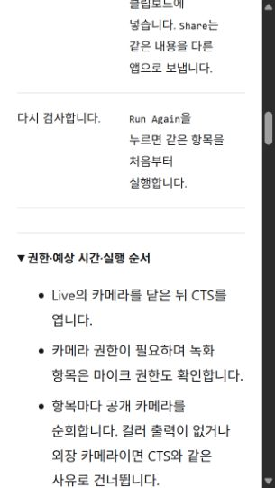
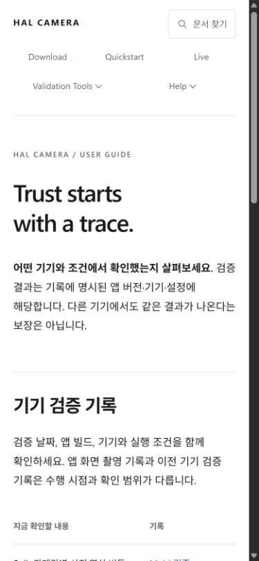
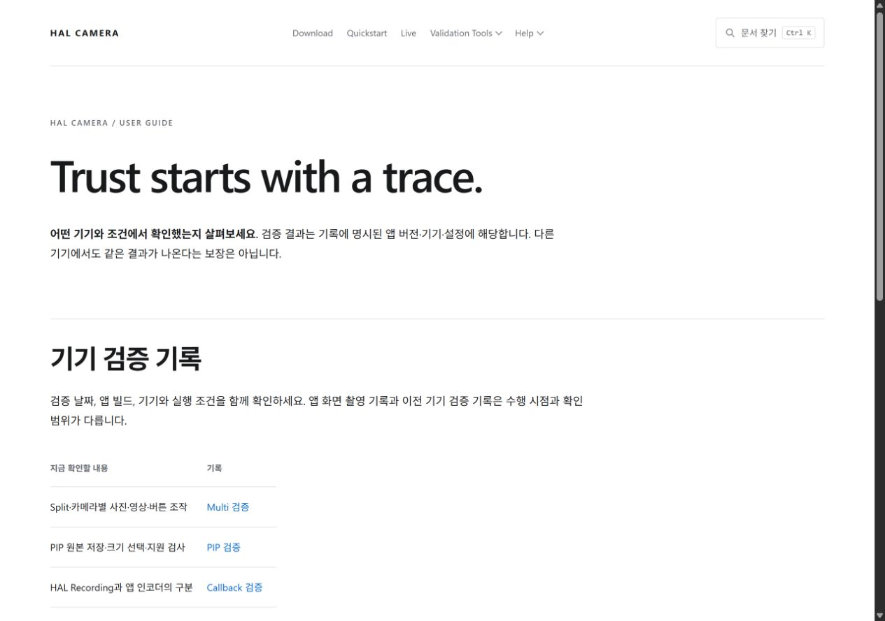

# 공개 안내 페이지 정리 검증 — 2026-10-17

## 기준과 변경

처음 방문한 독자가 기능·조건을 이해하고 설치·사용으로 이어지는 데 필요한 설명을 우선했습니다. 광고 목적이라도 지원 조건이나 검증 한계를 삭제하지 않았습니다.

- Probe·Benchmark: 클래스와 파일 목록 등 구현 근거 나열 제거.
- CTS: 내부 러너 설명·개발 절차를 저장소의 docs/design/CTS-IMPLEMENTATION-NOTES.md로 분리. Android 14 조건, 앱 내 검사와 공식 인증의 차이, 중단·결과 해석은 유지.
- Callback: 현재 버튼과 다른 과거 화면 안내 및 링크 제거. 과거 실측 기록은 Validation에서 유지.
- Agents: 저장소 로컬 스킬 진입점 안내를 빼고 APK·스킬의 같은 릴리스 사용을 안내.
- Validation: 문서 생성·기여 절차 대신 기기·조건·버전별 검증 범위를 먼저 안내. 다음 단계는 Download·Quickstart.
- Live·Probe·CTS·Benchmark·Engine·Troubleshooting·CLI: 이미지 아래의 중복 원본 보기 링크 제거. 이미지 자체의 원본 링크는 유지.
- 공통 하단: Glossary·Engine Comparison·Validation만 유지. 개발용 페이지는 파일을 삭제하지 않고 공통 링크와 사용자 검색에서 제외.
- 검색: architecture/building/contributing/decisions 및 _inputs 페이지 제외. 캐시된 기존 검색 스크립트와 구분하도록 search-v2.js로 배포.

## 검증

- docflow check: 6단계 통과. site check와 diff whitespace 검사 통과.
- npm test --prefix tools/docgen: 35개 통과. 검색 대상 분류와 생성 페이지의 내부 링크 포함.
- IAB 320px: CTS, Probe, Callback, Benchmark, Agents, Validation, Automation, CLI, Live, Engine Comparison, Troubleshooting 11개 페이지의 가로 넘침 없음. 이미지 검사 시 깨진 로드 완료 이미지는 없음.
- CTS의 권한·예상 시간 상세 펼침 확인. 390×844와 1280×900에서 Validation 화면 확인.
- APK 검색: 5개 사용자 문서에서 12개 결과. Quickstart 설치 안내가 첫 결과이며 Build·Architecture 결과 없음.
- 물리 휴대폰이나 Android 카메라 실행 검증은 수행하지 않았습니다. 앱 구현은 변경하지 않았습니다.

