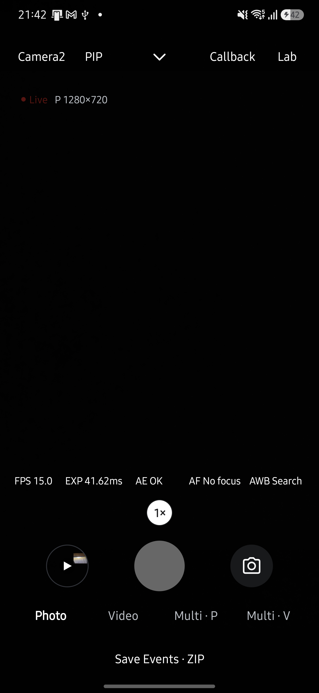
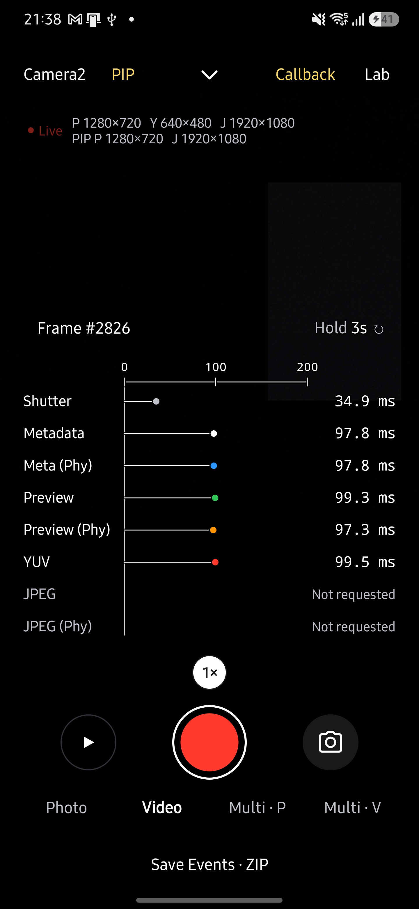

# 녹화 Callback과 활성 스트림 표시 검증

**Callback에는 카메라 출력만 표시하고 앱 변환·합성·인코더 출력은 제외합니다.** 2026-10-11, Galaxy S25+ (SM-S936N), Android 16/API 36, Qualcomm SM8750에서 서명된 0.24.0 release APK를 데이터 보존 업데이트로 설치했습니다.

## 경로별 판정

| 경로 | 카메라 Recording 출력 | Callback 표시 |
| --- | --- | --- |
| 일반 Camera2 VIDEO | 별도 HAL 출력 | Android 13 이상·EIS Off는 버퍼 시각을 관측합니다. EIS 직접 인코더 경로와 이전 Android에서는 No callback입니다. |
| 일반 CameraX VIDEO | VideoCapture의 카메라 출력 | Recording·No callback입니다. 인코더 버퍼 시각은 만들지 않습니다. |
| Camera2 Physical·Service PIP VIDEO | 별도 출력 없음 | 카메라 프리뷰만 합성기로 들어가므로 앱 합성 Recording 행은 없습니다. |
| CameraX Service PIP VIDEO | 별도 출력 없음 | 두 Preview 입력과 원본 촬영 출력만 표시합니다. |
| Camera2 Dual VIDEO | 두 물리 HAL 출력 | 누락되던 두 Recording 행을 등록하고 No callback으로 표시합니다. 요청 생성 때 대상 ID를 고정합니다. |
| CameraX Dual VIDEO | 별도 출력 없음 | 프리뷰를 GPU로 두 앱 인코더에 전달하므로 Recording 행은 없습니다. 지원하지 않는 사진 행도 제외합니다. |

Dual의 TextureView 화면 갱신은 HAL 버퍼 도착을 직접 관측한 값이 아니므로 Main/Sub Preview를 No callback으로 표시합니다. 같은 출력 구성의 사진 프리뷰 복원은 Callback 기준 시각과 Hold를 유지합니다. Multi에는 Callback 조작부가 없어 이번 그래프 검사 대상에 포함하지 않습니다.

## 기기에서 확인한 결과

- 일반 Camera2 녹화에서 Recording 도착값 94.2 ms를 확인했습니다. 시작 전과 종료 후에는 Not requested였습니다.
- Camera2 Physical PIP는 논리 ID 0과 물리 ID 6, Service PIP는 ID 0+1로 녹화했습니다. 두 Service ID에서 앱 Recording 행이 나타나지 않았고, PIP 종료 후 일반 Recording이 복원됐습니다.
- 일반 CameraX 녹화의 Recording·No callback과 CameraX Service PIP 0+1의 앱 Recording 제외를 확인했습니다.
- Camera2·CameraX Dual은 논리 ID 0, 물리 ID 5+6으로 녹화하고 MP4 두 개 저장을 확인했습니다. Camera2 Dual 사진 두 장 저장과 프리뷰 복원도 확인했습니다.
- YUV·JPEG·RAW Off에서는 Live에 P 1280×720만 표시됐습니다. YUV JPEG 선택에서는 J YUV (640×480)를 유지하고 사진을 저장했지만 Callback에는 변환 완료 행이 없었습니다.

앱 녹화·저장 기능은 그대로 유지합니다. 앱 변환과 합성 이벤트는 원본 진단 이벤트에 남지만 Camera Callback 그래프에 추가하지 않습니다.

## 자동 검사와 한계

전체 JVM 테스트 790개, release 빌드, lint, 문서 회귀 검사 33개와 문서 최신성 검사를 통과했습니다. 모델 리뷰에서 발견한 Dual 촬영 후 기준 시각 초기화와 녹화 시작 시 이전 요청의 대상 오인 문제를 수정한 뒤 재리뷰했습니다.

Exynos와 이전 Android 기기는 이번 기기 검증에 포함하지 않았습니다. 기기 모델이나 센서 ID를 제품 로직에 하드코딩하지 않았으며 위 ID는 검증 기기의 실제 선택값입니다. EIS와 이전 Android의 관측 한계는 코드 경로 분석 결과입니다.

