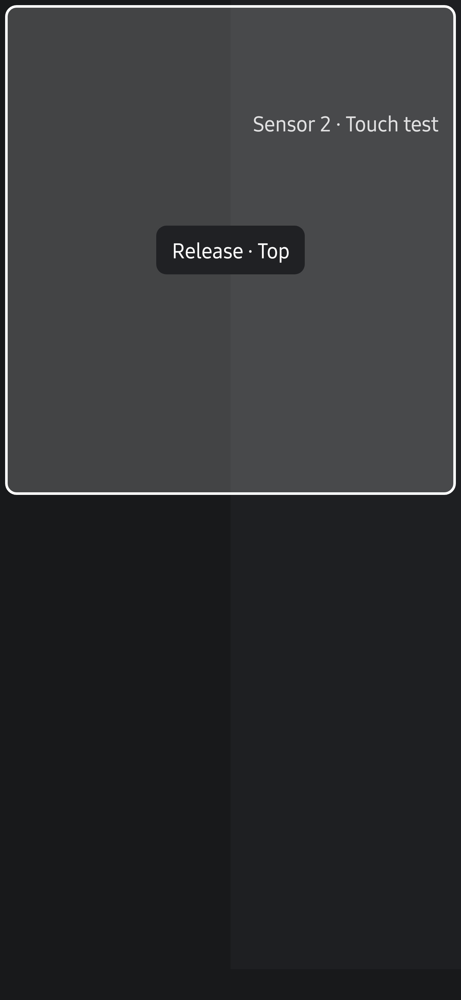

# Split 화면 끌기 검증

센서 이름표를 250ms 누른 뒤 약 24dp를 끌면 원하는 방향의 배치를 제안하도록 수정했습니다. 패널 이동량은 손가락 이동량과 같습니다. 기존에는 패널 중심이 미리보기 영역의 가장자리 22%에 진입해야 해서 좌우 배치에서 위로 옮길 때 영역 높이의 약 28%를 이동해야 했습니다. 새 판정은 화면의 위치나 높이 대신 시작 위치에서의 방향과 거리를 사용합니다.

## 실제 카메라 화면

Galaxy S25+ (`SM-S936N`, Android 16), Camera2, 후면 0과 전면 1의 Multi P에서 확인했습니다. 0.29.2 기반 수정 APK를 기존 release 서명으로 덮어 설치했습니다.

| 시나리오 | 결과 |
| --- | --- |
| 기존 앱에서 전면 이름표를 위로 60dp 이동 | 좌우 배치의 오른쪽 칸이 계속 제안됐습니다. |
| 수정 앱에서 같은 거리로 이동 | 상단 절반의 테두리와 `Release · Top` 안내가 나타났고, 놓은 뒤 전면 화면이 위로 이동했습니다. |
| 후면 화면을 오른쪽·아래·위·왼쪽으로 각각 60dp 이동 | 각 방향의 배치와 화면 순서가 적용됐습니다. 마지막에는 원래 후면 왼쪽·전면 오른쪽 배치로 복원했습니다. |
| 이름표를 잡고 위로 12dp 이동 | 기존 좌우 배치와 화면 순서를 유지했습니다. |
| 위로 60dp 이동 후 시작 위치로 복귀하고 놓기 | 기존 좌우 배치와 화면 순서를 유지했습니다. |

위 표는 첫 56dp 기준에서의 검증입니다. 최종 기준은 사용자 피드백에 따라 24dp로 낮췄고 누르기 시간 250ms는 유지했습니다. 최종 소스의 별도 검증 패키지에서 다음 결과를 추가로 확인했습니다.

| 최종 24dp 기준 시나리오 | 결과 |
| --- | --- |
| Side by Side에서 이름표를 잡고 위로 25dp 이동 | Top/Bottom으로 바뀌며 해당 카메라가 위에 놓였습니다. |
| Top/Bottom에서 이름표를 잡고 왼쪽으로 25dp 이동 | Side by Side로 바뀌며 해당 카메라가 왼쪽에 놓였습니다. |
| 오른쪽·아래로 각각 25dp 이동 | 같은 거리에서 각 방향의 배치·순서가 적용됐습니다. |
| 12dp 이동 또는 25dp 이동 후 시작점 복귀 | 기존 배치와 순서를 유지했습니다. |

실제 카메라 화면의 스크린샷은 로컬 검토 자료로 확인했습니다. 카메라 영상이 포함되어 저장소에 추가하지 않았습니다. 아래 스크린샷은 같은 `SplitPanelDrag`를 실제 Android View에 붙인 회귀 시험 화면으로, 카메라 입력 없이 상단 배치 안내와 손가락 이동량을 확인합니다. 사진·동영상 저장 검사는 이번 변경의 범위에 포함하지 않습니다. 카메라 3개 이상의 대각선 격자 전환은 JVM 검사로만 확인했습니다.

## 자동 검사

- `testDebugUnitTest`: app JVM 테스트 846개가 통과했습니다. 전환 거리, 네 방향 배치, 대각선 흔들림, 전환 유지·해제 경계, 작은 영역과 3개 이상 패널을 검사했습니다. 두 배치·두 창·양쪽 순서·네 방향·세 화면 밀도·세로 및 가로 화면의 192개 조합에서 23dp까지는 배치를 유지하고 24dp에서 방향을 판정하는 회귀 검사도 추가했습니다.
- `lintDebug`: 문제가 없었습니다.
- `assembleRelease`, `assembleDebugAndroidTest`: 빌드가 통과했습니다. 기기 검사용 테스트 APK도 기존 앱과 같은 서명으로 빌드했습니다.
- `am instrument -w -e split_drag true dev.halcamera.test/dev.halcamera.cli.CliStoreInstrumentation`: 실제로 붙어 있는 Android View에서 짧은 탭, 이동 없는 길게 누르기, 24dp 전환, 손가락과 같은 이동량, 시작점 복귀, ACTION_CANCEL, 비활성화된 상태의 놓기, 추가 손가락과 뷰 분리가 통과했습니다. 이 검사는 카메라를 촬영하지 않습니다.
- 문서 회귀 검사 37개와 `check --build`의 6단계가 통과했습니다. 남아 있던 최신성 검토 9건은 아래 범위로 코드와 대조한 뒤 사용자 요청에 따라 검토 기록을 갱신했습니다. 변경 동작은 구조 원본, 모듈 역할과 사용자 안내에 반영하고 배포 문서를 다시 생성했습니다.

## 문서 검토 범위

2026-10-18 사용자 요청에 따라 Codex가 `verify --changes`로 각 항목의 이전 검토 이후 변경을 확인했습니다. 9건 모두 같은 구조 관점을 근거로 삼아 `SplitArrangement`, `SplitPanelDrag` 변경과 새 `SplitDragGesture` 때문에 최신성이 바뀌었습니다. 이번 코드 대조는 기존 기기 검증 V-002의 재실측을 뜻하지 않습니다.

| 검토 키 | 대조 결과 |
| --- | --- |
| `omm:overall-architecture` | 분할 배치 원본의 24dp·18% 제한, 70% 복귀 기준, 축 전환 1.2배와 대각선 진입·유지 조건을 코드 및 JVM 검사와 대조했습니다. |
| `content:architecture.md/overview` | 화면·측정·CLI 연결의 변경이 없음을 확인했습니다. |
| `content:architecture.md/module-roles` | 순수 배치·제스처 판정과 Android 터치 어댑터의 역할을 보강했습니다. |
| `content:architecture.md/constraints` | 순수 Kotlin 경계, close 완료 순서와 보고서 계약에 변경이 없음을 확인했습니다. |
| `content:_reference/engine.md/contract` | 엔진 인터페이스와 기능 지원 조건에 변경이 없음을 확인했습니다. |
| `content:_reference/engine.md/camera2` | 카메라 요청·출력·녹화 경로에 변경이 없음을 확인했습니다. |
| `content:_reference/engine.md/camerax` | 바인딩·출력·제어 경로에 변경이 없음을 확인했습니다. |
| `content:_reference/engine.md/comparison` | 배치·순서만 바꾸면 기존 세션을 유지한다는 설명을 Activity의 onDrop 경로와 대조했습니다. |
| `content:_reference/evidence.md/device-notes` | V-002의 관측 기록과 연결된 CameraX 제어·촬영 코드에 변경이 없어 기존 기록을 유지했습니다. |

조작 방법은 [Multi 사용 안내](../../guide/live.md#여러-카메라를-함께-촬영하세요)에서 확인할 수 있습니다.
