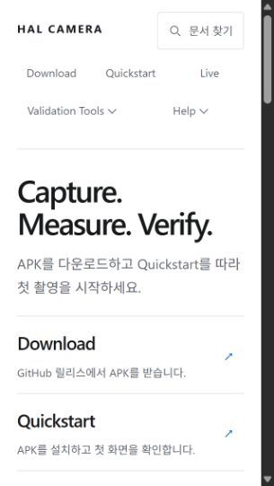
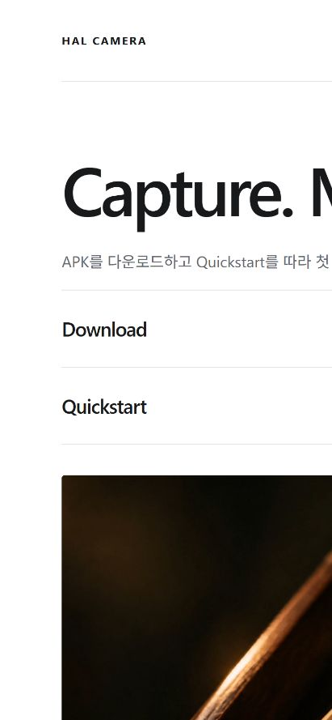

# 광고용 문서 UI 정리 검증 — 2026-10-17

- 홈의 중복 표제·긴 안내문과 작은 화면의 여백을 줄였습니다.
- 320×568에서 Download·Quickstart 링크 전체가 첫 화면에 표시됩니다(Quickstart 하단 약 550px). 390×844와 1280×900도 확인했습니다. 가로 넘침은 없습니다.
- '다운로드' 검색 시 Download 페이지가 첫 결과로 표시됩니다.
- 영상은 native controls로 직접 재생하며 preload=none입니다. 최초 로드에서 paused=true, readyState=0을 확인했습니다. 자동 재생 스크립트는 제거했습니다.
- 사용자의 광고용 문서 방침에 따라 Quickstart의 과거 Live 링크 목록·앵커를 삭제했습니다. 호환용 숨김 목록이나 리디렉션도 남기지 않습니다. 현재 Live로 가는 다음 단계 링크는 유지합니다.
- npm test --prefix tools/docgen: 34개 통과. 문서 파이프라인 및 내부 링크 검사 통과.
- 브라우저 viewport 검증이며 물리 휴대폰·카메라 하드웨어 검증은 수행하지 않았습니다.

