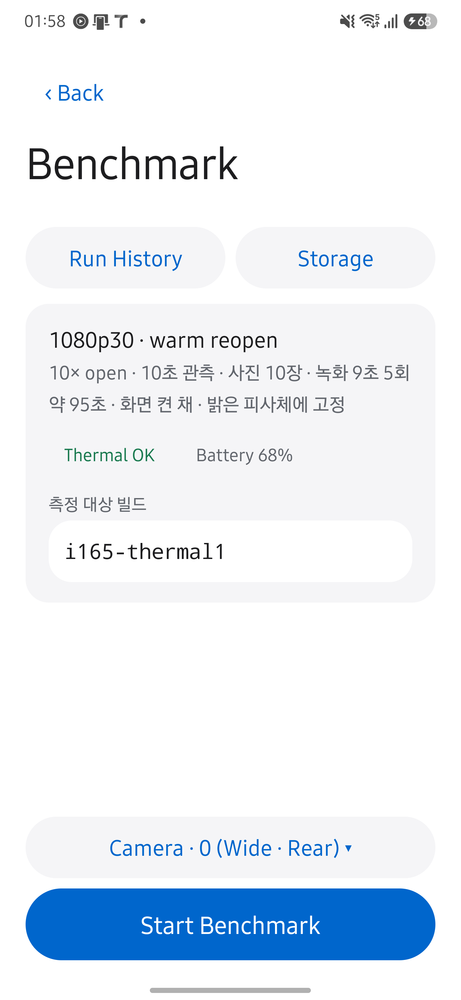
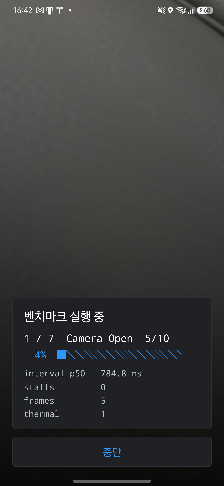
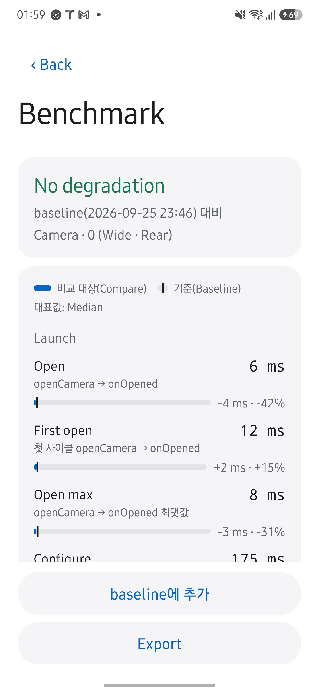
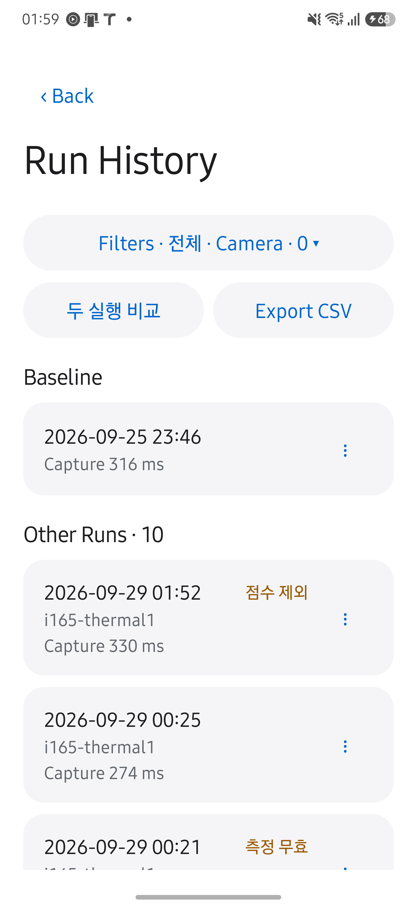

<h1 lang="en">Measurements with meaning.</h1>

같은 조건에서도, 카메라의 응답은 조금씩 달라집니다.

**먼저 설정을 바꾸지 않고 두 번 측정해 보세요.** Benchmark는 카메라 열기·프리뷰·촬영·녹화에 걸린 시간과 콜백을 기록합니다.

스크린샷은 당시 빌드의 기록입니다. <a href="evidence.html#앱-화면-촬영">촬영 기기·버전·확인 범위</a>를 함께 읽으세요.

## 실행 조건을 확인하세요

1. Live에서 `Lab → Benchmark`를 엽니다.
2. 카메라와 [profile](glossary.md#profile)을 확인합니다. Live의 출력 설정과는 별개입니다.
3. 측정을 실행하고 완료될 때까지 기다립니다.
4. 판정과 `Run Details`를 확인합니다. 무효·표본 부족이면 사유를 확인한 뒤 다시 측정합니다.

**현재 앱은 종합 점수를 계산하지 않습니다.** 지표별 측정값과 baseline 대비 저하 판정을 확인하세요.

한 번의 차이를 HAL 변경의 효과로 단정하지 말고, 같은 조건에서 반복되는지 확인하세요.

### 비교 기준을 고르세요

1. Benchmark의 `Run History` 또는 `Lab → Run History`를 엽니다.
2. 기준으로 쓸 정상 실행의 `⋮` 메뉴에서 `baseline에 추가`를 선택합니다.
3. 같은 카메라·profile과 환경에서 다시 측정합니다.
4. 결과의 판정과 달라진 지표를 확인합니다.

반복 측정에서는 정상 실행을 다섯 개 이상 baseline에 추가하기를 권장합니다.

- **처음 측정했다면** 비교할 실행이 없으므로 측정값만 봅니다.
- **baseline을 지정하지 않았다면** 이전의 비교 가능한 실행과 변화량만 표시합니다. 저하·개선은 판정하지 않습니다.
- **정상 실행을 `baseline에 추가`했다면** 추가한 정상 실행들의 집합을 기준으로 삼습니다. 집합의 가장 나쁜 값보다 임계값 이상 나쁠 때 저하로 판정합니다.
- **실행 기록에서 `두 실행 비교`를 골랐다면** 먼저 고른 실행을 이번 비교에만 씁니다. 그 실행을 기준으로 저하·개선을 판정하며, 저장된 baseline은 바뀌지 않습니다.

3A(AE·AF·AWB 수렴)는 장면에 따라 값이 크게 달라집니다. **3A는 변화량만 표시하며 저하로 판정하지 않습니다.**

비교하기 전에는 다음 조건을 확인하세요.

- **카메라와 profile:** `camera2-standard-v1`과 녹화를 포함하는 `camera2-standard-v2`는 서로 비교하지 않습니다. v2의 baseline은 기기별로 새로 지정합니다.
- **관측 창과 워밍업:** 카메라를 다시 여는 반복 측정과 프리뷰 관측 세션은 구분됩니다. 관측 시작 전에 도착한 프레임은 워밍업으로 제외합니다.
- **유효성과 환경:** 표본 수, 발열, 충전 상태, 빌드 정보를 `Run Details`에서 확인합니다. 비교 조건이 맞지 않으면 이유를 표시합니다.

실제 화면 보기

<figure class="app-screenshot">

<figcaption>카메라 0에서 실행하기 전의 조건입니다. 기기에 저장된 측정 대상 빌드 이름을 그대로 표시합니다.</figcaption>
</figure>

실제 화면 보기

<figure class="app-screenshot">

<figcaption>카메라 열기 반복 측정이 진행 중입니다. 현재 단계와 회차, 진행률을 확인할 수 있습니다.</figcaption>
</figure>

진행 표시와 녹화 표본의 세부 규칙

진행률은 표시용 추정치이며 측정값에 영향을 주지 않습니다.

`camera2-standard-v2`는 사진 촬영을 마친 뒤 카메라를 닫지 않고 9초 녹화를 다섯 번 반복합니다.

첫 회를 워밍업으로 제외하므로 녹화 지표의 유효 표본은 네 개입니다. 이때 p95는 사실상 최대값입니다.

녹화를 마지막에 실행하므로 녹화 세션 구성의 영향이 앞선 프리뷰 관측과 촬영 지연에 섞이지 않습니다.

녹화 표본이 부족하면 `녹화 측정이 부족함` flag가 붙습니다. 이 flag만으로 측정 전체가 무효가 되지는 않습니다.

지표별 표본과 비교 가능 여부를 확인하세요. 카메라가 녹화 스트림 조합을 거부하면 남은 녹화 회차는 실행하지 않습니다.

## 판정과 막대를 읽으세요

**판정을 먼저 읽고, 달라진 지표를 확인하세요.** 막대만 보고 성능 저하를 판단하지 마세요.

<figure class="doc-visual" aria-labelledby="metric-example-title">

<strong>시간 지표 한 줄 읽기</strong> · 설명용 예시

<dl class="doc-metric-key">
<dt>막대 · 이번 값</dt><dd>120 ms</dd>

<dt>눈금 · 기준 값</dt><dd>100 ms</dd>

<dt>변화량</dt><dd>+20 ms (+20%)</dd>
</dl>
<figcaption>이 예시에서는 20 ms 더 걸렸습니다. 실제 저하 판정은 비교 조건과 지표별 임계값으로 결정합니다. 실측 결과나 앱 화면이 아닙니다.</figcaption>
</figure>

- **`Measurement invalid`:** 측정 유효성 조건을 충족하지 못했습니다. `Run Details`에서 무효 사유를 확인하고 조건을 바로잡은 뒤 다시 측정하세요.
- **`First run`:** 비교할 실행이 없습니다. 이번 조건과 측정값을 확인하고 같은 조건으로 다음 실행을 측정하세요.
- **`This run is the baseline`:** 현재 실행이 기준입니다. 비교할 다른 실행을 선택하세요.
- **`No baseline`:** 이전 실행과의 변화량만 보입니다. 저하 판정이 필요하면 정상 실행을 baseline에 추가하세요.
- **`No verdict`:** 기준은 있지만 비교 조건을 충족한 지표가 없습니다. `Run Details`에서 비교 불가 사유를 확인하세요.

- **`N metrics degraded`:** 저하된 지표가 N개입니다. 해당 지표와 실행 조건 차이를 확인하고 같은 조건에서 재현되는지 측정하세요.
- **`No degradation`:** 판정한 지표에는 저하가 없습니다. 제외된 지표와 경고도 확인하세요. 모든 HAL 동작이 정상이라는 뜻은 아닙니다.

실제 화면 보기

<figure class="app-screenshot">

<figcaption>실행 완료 후 기존 baseline과 비교한 화면입니다. 충전 중 측정의 점수 제외 안내가 표시되므로, 이 장면을 앱 버전 간 성능 저하의 증거로 해석하지 않습니다.</figcaption>
</figure>

막대·단위·프레임 지표 자세히 읽기

지표는 `Launch`·`Preview`·`Capture`·`Stability`·`Record`·`3A`로 묶습니다. 막대는 비교 대상의 값, 눈금은 baseline 또는 이전 실행의 값입니다.

시간 값의 대표값은 중앙값이며, 각 지표 아래에는 측정한 Camera2 구간을 표시합니다. 지표 정의는 [METRICS.md](https://github.com/TTolsun/hal-camera/blob/main/docs/METRICS.md)를 확인하세요.

Benchmark의 `Partial`은 `onCaptureStarted → onCaptureCompleted` 구간을 뜻합니다. Camera2의 중간 메타데이터 콜백인 `onCaptureProgressed`를 뜻하지 않습니다.

- **막대 길이:** 같은 묶음에서 단위가 같은 지표끼리 축을 공유하며, 이번 실행의 최댓값이 트랙의 80%에 옵니다. 단위가 다른 행이나 다른 묶음의 길이는 직접 비교하지 않습니다.
- **별도 축:** 묶음에서 단위가 하나뿐인 지표와 `Jitter`·`Record jitter`는 자체 축을 씁니다.
- **끝의 ▸:** 기준 값이 표시 범위를 넘었습니다.
- **변화량:** 시간·비율 지표는 절댓값과 변화율을, 개수 지표는 절댓값만 표시합니다. 단위가 다르면 변화율을 표시하지 않습니다.
- **빨강·초록·회색:** 각각 저하, 개선, 판정하지 않은 변화를 뜻합니다. 이전 실행과의 비교는 회색으로 표시합니다.

- **`timeout`:** 3A가 관측 창 안에 수렴하지 않았습니다. 현재 값의 막대는 비우며, 기준 값이 timeout이면 눈금과 변화량을 표시하지 않습니다.
- **`Baseline에만 있음`:** 기준 실행에만 값이 있습니다. 현재 값은 `—`로 표시하고 기준 눈금은 남깁니다.
- **`조건 불일치`·`표본 부족`:** 해당 지표를 판정하지 못한 이유입니다.

`Stalls`·`Callback fail`·`Record stalls`는 막대 없이 개수를 표시합니다. 기준과 같으면 변화량을 생략합니다.

지표별 계산식과 임계값은 [METRICS.md](https://github.com/TTolsun/hal-camera/blob/main/docs/METRICS.md)를 확인하세요. `Partial`은 중간 메타데이터 콜백을 뜻하지 않습니다.

이 수치만으로 HAL 내부의 프레임 손실을 확정할 수는 없습니다.

`Run Details`에는 기기, 카메라, OS 빌드, subject, 표본 수, 발열, 비고, 파일과 비교 기준의 정보가 있습니다.

validity flag는 화면에서는 뜻을 풀어 쓰고 JSON과 CSV에는 원래 코드를 유지합니다. `Export`로 결과 파일을 공유합니다.

## 실행 기록에서 비교하고 내보내세요

`Lab → Run History`에서 실행 기록을 엽니다. 지정된 baseline을 위에, 나머지 실행을 최신순으로 표시합니다.

- **`▲ N degraded`:** 지정된 baseline 대비 N개 지표가 저하되었습니다.
- **`측정 무효`·`비교 불가`·`점수 제외`:** 결과의 사용 조건을 충족하지 못했습니다. `점수 제외`는 호환용 적격성 표시이며 현재 점수를 계산한다는 뜻은 아닙니다.
- **배지가 없다면** 저하나 적격성 경고가 없는 실행이거나, 별도 `Baseline` 묶음에 있는 실행입니다.

두 실행을 직접 비교하려면 다음 순서로 고릅니다.

1. `두 실행 비교`를 누릅니다.
2. 기준으로 쓸 실행을 먼저 고릅니다.
3. 비교할 실행을 고릅니다. 취소나 뒤로 가기로 선택을 해제할 수 있습니다.

- **실행 하나를 관리하려면** 행의 `⋮` 메뉴를 누르거나 길게 누릅니다. baseline 추가·빼기, 비교, JSON·CSV 내보내기, 삭제를 고릅니다.
- **실행 삭제를 선택하면** 확인을 거쳐 실행을 지우고 baseline에서도 뺍니다.
- **현재 목록을 내보내려면** `Export CSV`를 누릅니다. 현재 필터에 맞는 실행을 CSV 하나로 저장합니다.

실제 화면 보기

<figure class="app-screenshot">

<figcaption>저장된 실행을 최신 순서로 표시합니다. 기존 baseline은 별도 묶음에 남아 있습니다.</figcaption>
</figure>

기본 상태 필터는 `전체`이므로 중단·무효 실행도 보입니다.

찾는 실행이 없으면 profile·camera 조건을 확인하거나 `Reset Filters`를 누르세요.

PC 집계에서 실행 개수가 다를 때

PC의 `tools/aggregate.py`는 기존 점수 적격성 조건으로 필터링합니다. 점수의 유무와는 별개입니다.

전체 실행이 필요하면 `--eligibility all`을 사용합니다.

오래된 실행의 자동 삭제와 손상 파일 처리

저장 직후에는 `Storage → Storage Limit`에서 정한 한도를 적용해 오래된 실행부터 삭제합니다.

한도는 10부터 100까지 10 단위로 선택하거나 `무제한`으로 지정합니다. 기본값은 `무제한`입니다.

baseline에 든 실행은 자동 삭제하지 않습니다.

손상된 JSON은 별도로 알립니다. baseline 파일을 읽지 못하면 baseline 변경과 삭제를 중단합니다.

## 결과를 해석할 때 확인하세요

표본이 없거나 비교 결과가 예상과 다르면 [Troubleshooting](troubleshooting.md)을 확인하세요. 실제로 확인한 기기·조건·한계는 [Validation](evidence.md)에 있습니다.

**다음 단계:** 프리뷰에서 개별 프레임의 콜백 도착 순서를 보려면 [Callback](callback.md)을 확인하세요.
