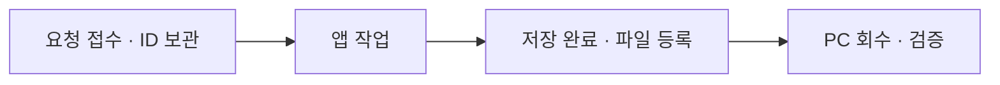

<h1 lang="en">Take a photo. Change one thing.</h1>

사진 한 장을 찍고, 조건 하나를 바꾸어 봅니다.

**먼저 사진을 PC에 받아 열어 보세요.** 필요한 것은 `adb`와 HAL CAM APK입니다.

## 처음 실행하세요

1. `adb devices -l`로 기기를 찾습니다. `unauthorized`이면 기기에서 디버깅을 허용하고, `offline`이면 연결을 복구합니다.

   여러 연결이 보이면 이후 모든 명령과 파일 회수에 같은 `adb -s SERIAL`을 사용합니다.

2. APK가 없으면 `adb install -r HALCamera.apk`로 설치합니다. 서명이 맞지 않으면 같은 서명의 APK를 준비하고 기존 앱을 삭제하지 않습니다.

   앱에서 카메라 권한을 허용하고 화면 잠금을 해제합니다.
3. 앱에 들어 있는 실행 스크립트를 준비하고 카메라 ID를 조회합니다. APK 업데이트 후에도 첫 명령으로 스크립트를 갱신합니다.

   ```sh
   adb shell "content read --uri content://dev.halcamera.cli/v1/shell > /data/local/tmp/halcam"
   adb shell sh /data/local/tmp/halcam doctor
   adb shell sh /data/local/tmp/halcam cameras
   ```

   `doctor`가 준비 부족을 알리면 표시된 조치부터 해결하세요.

   ADB CLI는 기본 허용이며, 직접 꺼 두었다면 앱의 **Lab → ADB CLI**에서 켭니다. 업데이트해도 꺼 둔 설정은 유지됩니다.
4. 조회 결과에서 `selectable: true`인 논리 ID로 아래의 `0`을 바꿔 촬영합니다. 완료 후 출력된 `adb pull` 명령으로 PC에 받습니다.

   ```sh
   adb shell sh /data/local/tmp/halcam capture --camera 0
   ```

JPEG와 촬영 JSON을 받습니다. 앱 열기·요청 ID 생성·완료 대기는 스크립트가 처리합니다.

<details>
<summary>ADB를 찾지 못하거나 Windows·WSL에서 연결이 다를 때</summary>

`adb version`이 실패하면 Android SDK Platform-Tools의 실행 파일을 전체 경로로 호출하거나 PATH에 추가합니다.

- Windows는 PowerShell·CMD에서 실행합니다.

  Git Bash는 먼저 `export MSYS2_ARG_CONV_EXCL='*' MSYS_NO_PATHCONV=1`을 설정해야 기기 경로가 Windows 경로로 바뀌지 않습니다.
- WSL은 Linux `adb`로 무선·USB 연결을 사용하거나 Windows `adb.exe`를 호출합니다.

  Windows 실행 파일로 `pull`하면 `C:/Users/USERNAME/Downloads` 같은 Windows 대상 경로를 씁니다. 실행·조회·회수에 같은 ADB 실행 파일을 유지합니다.

- 무선 연결은 `adb pair IP:PAIR_PORT` 후 `adb connect IP:PORT`입니다.

  주소·코드는 기기의 무선 디버깅 화면에서 확인하며 두 포트는 다를 수 있습니다. 같은 기기의 USB·무선 연결도 별도로 선택합니다.

WSL에서 Windows ADB를 호출하려면 사용자명과 SDK 경로를 바꿉니다.

```sh
adb() { "/mnt/c/Users/USERNAME/AppData/Local/Android/Sdk/platform-tools/adb.exe" "$@"; }
adb devices -l
```

</details>

## 필요한 작업 하나를 고르세요

- **영상을 저장하거나 녹화 중 사진을 찍으려면** [영상 10초](#영상-10초를-저장하세요)를 확인하세요.
- **JPEG·RAW·연사·HDR을 비교하려면** [사진 실험](#사진의-차이를-비교하세요)을 확인하세요.
- **두 카메라로 찍으려면** [PIP와 Dual](#pip로-한-장과-원본을-비교하세요)을 확인하세요.
- **성능을 측정하거나 CTS를 실행하려면** [벤치마크](#벤치마크를-실행하세요)와 [CTS](#cts와-다른-작업을-찾으세요)를 확인하세요.
- **연결이 끊겼거나 파일이 없다면** [기존 요청 복구](#요청이-끝나지-않거나-파일이-없을-때)부터 확인하세요.

**아래의 짧은 명령은 `adb shell sh /data/local/tmp/halcam` 뒤에 붙입니다.** 전체 문법은 이 접두어에 `help all`을 붙여 확인합니다.

Python 도구는 [선택 사항](#python-client)입니다. 수동 제어는 `help controls`로 조회하세요.

<details markdown="1" id="cli-task-examples" data-search-section>
<summary>촬영·스트림·벤치마크 예시</summary>

### 영상 10초를 저장하세요

1. 무음 녹화를 시작합니다. 소리가 필요하면 `--no-audio`를 빼고 앱에서 마이크 권한을 허용하세요.

   ```sh
   adb shell sh /data/local/tmp/halcam record start --camera 0 --no-audio
   ```

2. `Recording started`가 표시된 뒤 10초를 촬영하고 종료합니다. `record stop`은 MP4 저장 완료까지 기다립니다.

   ```sh
   adb shell sh /data/local/tmp/halcam record stop
   ```

**출력된 `adb pull` 명령으로 받은 MP4를 재생하세요.** `record start`의 성공은 녹화 시작이고 파일 저장 완료는 아닙니다.

녹화 중 사진도 필요하면 종료 전에 `record snapshot`을 실행합니다. 저장 중 종료를 요청해도 사진 저장을 기다리며 MP4와 사진을 함께 받습니다.

스냅샷 지원은 엔진·출력 구성에 따라 다릅니다. 화면에서 시작한 녹화는 CLI로 멈추지 않습니다.

### 사진의 차이를 비교하세요

- **카메라 JPEG와 앱 변환 JPEG를 비교합니다.**

  `capture --camera 0 --jpeg-size yuv`

  YUV에서 만든 JPEG와 촬영 JSON을 확인합니다. 원본 YUV 파일을 지정하는 옵션은 아닙니다.

- **움직이는 피사체를 세 번 찍습니다.**

  `burst --camera 0 --count 3 --interval-ms 500`

  저장한 장수와 목표 장수를 비교합니다.

- **서로 다른 노출로 찍습니다.**

  `bracket --camera 0`

  AEB 원본과 가능한 HDR을 확인합니다. HDR을 만들지 못하면 생략 이유를 읽습니다.

- **RAW를 저장합니다.**

  `capture --camera 0 --yuv-size off --jpeg-size off --raw-size WIDTHxHEIGHT`

  `streams`에서 고른 크기의 DNG를 확인합니다. Camera2와 RAW 지원이 필요합니다.

출력 크기나 수동 설정을 바꾸려면 [지원 조건](#스트림-크기를-지정하세요)을 먼저 확인하세요.

### PIP로 한 장과 원본을 비교하세요

PIP 사진은 합성 사진과 두 카메라의 원본을 비교할 수 있습니다. 영상은 합성 MP4를 저장합니다.

1. 원하는 카메라·엔진·모드로 프리뷰를 열고 후보를 조회합니다. 영상이라면 첫 명령에 `--mode Video`를 붙입니다.

   ```sh
   adb shell sh /data/local/tmp/halcam preview --camera 0
   adb shell sh /data/local/tmp/halcam pip sources
   ```

2. `selectable: true`인 후보의 `type`과 ID를 사용합니다. 아래는 Service 후보를 선택한 예시이며 `ID`는 조회 값으로 바꿉니다.

   ```sh
   adb shell sh /data/local/tmp/halcam capture --camera 0 --pip-type service --pip-camera ID
   ```

조회와 촬영의 카메라·엔진을 맞추세요. `Not verified` 후보는 실제 구성에서 실패할 수 있습니다.

<details>
<summary>PIP 위치·크기, Dual의 두 원본 영상과 Multi 조합</summary>

PIP는 `preview`, `capture`, `record start`에서 선택합니다. CameraX Physical PIP, PIP Flash Auto/On, 연사·AEB PIP는 지원하지 않습니다.

PIP 크기는 `--pip-preview-size WIDTHxHEIGHT`, `--pip-photo-size WIDTHxHEIGHT`로 지정합니다.

위치는 `--pip-x`, `--pip-y`, `--pip-width`, `--pip-height` 네 값을 함께 지정합니다. 왼쪽 위를 0으로 하는 0–1 영역 안에 들어야 하며, 생략하면 기본 위치를 사용합니다.

Dual은 `dual cameras`에서 ID를 고른 뒤 `dual preview|capture|record --camera ID --first ID --second ID`로 실행합니다.

사진·수동 제어는 Camera2에서 지원합니다. 영상은 두 개의 무음 MP4로 저장하고 `record stop`으로 종료합니다.

물리 ID가 있어도 조합의 구성 성공까지 보장하지 않습니다.

Multi로 함께 열 수 있는 카메라 조합은 `multi cameras`로 조회합니다. 카메라를 열지 않고 화면도 바꾸지 않습니다.

조회한 조합과 크기를 사용하세요. 세부 결과 필드와 예시는 [배포용 CLI 스킬](https://github.com/TTolsun/hal-camera/blob/main/skills/halcam-cli/SKILL.md)에 있습니다.

Android 11 이상에서 `multi preview|capture|record --cameras 1,0 [--engine Camera2|CameraX]`로 실행합니다.

`--cameras`는 화면 순서입니다. `--preview-sizes 1280x720,1280x720`과 `--photo-sizes 1920x1440,1920x1440`도 같은 순서로 카메라마다 하나씩 지정합니다.

지원하지 않는 조합·크기는 `PREFLIGHT_FAILED`로 거부하며 자동 대체하지 않습니다.

Multi 녹화는 기본으로 마이크 소리를 포함합니다. `--no-audio`이면 마이크 권한 없이 무음으로 녹화하며, `record stop`으로 종료합니다.

CLI는 권한 대화상자를 띄우지 않으므로 소리가 필요하면 앱에서 마이크 권한을 먼저 허용하세요.

결과의 `cameras`에는 카메라별 `camera_id`, `saved`, `error`가 들어갑니다. 회수 파일은 `multi_요청ID_카메라ID.jpg|mp4`입니다.

사진 일부가 실패하면 `CAPTURE_FAILED`와 성공한 파일을 함께 보존합니다.

영상은 기존 Multi의 묶음 저장 규칙을 따르므로 하나라도 실패하면 전체 영상을 롤백합니다.

녹화 중 사진과 카메라별 제어·측광은 아직 CLI에서 제공하지 않습니다.

</details>

## 스트림 크기를 지정하세요

**조회와 실행에 같은 카메라·엔진·모드를 사용하세요.** 기본 엔진은 Camera2이며 CameraX는 양쪽 명령에 `--engine CameraX`를 붙입니다.

```sh
adb shell sh /data/local/tmp/halcam streams --camera 0 --mode Video
adb shell sh /data/local/tmp/halcam preview --camera 0 --mode Video --video-size 1280x720 --video-fps 30
```

프리뷰 준비만으로 녹화가 시작되지는 않습니다.

**Photo 모드에서는 다음 설정을 사용합니다.**

- **촬영:** `capture`·`burst`·`bracket`은 Photo입니다.
- **프리뷰·지원 조회:** `preview`·`streams`의 기본 모드입니다.
- **출력·FPS:** `--jpeg-size`, `--raw-size`, `--fps`를 사용합니다.
- **손떨림 보정:** Off이며 `AUTO`도 Off로 적용됩니다.

**Video 모드에서는 다음 설정을 사용합니다.**

- **녹화:** `record start`는 Video입니다.
- **프리뷰·지원 조회:** `preview`·`streams`에 `--mode Video`를 붙입니다.
- **출력·FPS:** `--video-size`, `--video-fps`, `--codec`을 사용합니다.
- **손떨림 보정:** `--stabilization`의 지원 값은 `streams`에서 확인합니다.

새 카메라 명령은 기본값과 명시한 옵션으로 구성합니다. 이전 UI·CLI 설정과 PIP를 이어받지 않습니다.

모드에 맞지 않거나 지원하지 않는 옵션은 `PREFLIGHT_FAILED`로 거부하며 다른 크기로 자동 변경하지 않습니다.

지원 목록은 개별 크기·인코더 조건입니다. 출력 조합의 성공까지 보장하지 않으므로 실제 세션 구성에서 실패할 수 있습니다.

적용된 값은 프리뷰·녹화 결과의 `result.streams`에서 확인합니다.

<details>
<summary>출력 형식과 수동 제어의 단위</summary>

크기는 `너비x높이` 형식입니다. YUV·JPEG·RAW는 `off`로 끌 수 있지만 촬영에는 JPEG 또는 RAW가 필요합니다.

Camera2 영상 코덱은 H264·HEVC, CameraX는 Auto이며 실제 코덱은 라이브러리가 선택합니다.

수동 옵션은 `help controls`로 조회합니다.

- `--ev`는 EV 자체가 아닌 보정 단계입니다. `ev_step`이 1/3 EV일 때 `--ev -3`은 −1 EV입니다.
- 수동 노출은 `--iso`와 `--exposure-ns`를 함께 지정합니다. `--iso 100 --exposure-ns 10000000`은 ISO 100·10 ms입니다.

  목록의 노출 범위는 30 FPS 기준이며 선택 FPS로 다시 검사합니다.
- `--focus`는 디옵터이며 0은 무한대입니다. CUSTOM WB는 수동 노출과 함께 사용하고 `--gains` 네 값·`--matrix` 아홉 값을 쉼표로 구분합니다.
- 현재 프리뷰·CLI 녹화를 유지하며 조절하려면 `live set --zoom 2`, 제어 초기화는 `live reset`을 사용합니다. 생략한 제어는 유지합니다.
- `meter --x 0.5 --y 0.5 --meter focus`는 가운데 초점, `--meter exposure`는 노출 측광입니다.

  명령 접수와 센서 적용은 다르므로 `live info`·사진 메타데이터로 실제 값을 확인합니다.

`live info`, `meter`, `events`, `preview stop`, `live set/reset`은 현재 열린 Live 또는 Dual 화면에 적용됩니다.

Multi에서는 `live info`, `events`, `preview stop`과 CLI 녹화의 `record stop`을 지원합니다. 엔진이 지원하지 않는 제어는 거부됩니다.

콜백의 시각 기준은 [Callback](callback.md#시간-기준을-확인하세요)과 [Timestamp](glossary.md#timestamp)를 함께 확인하세요.

</details>

## 벤치마크를 실행하세요

```sh
adb shell sh /data/local/tmp/halcam benchmark run --camera 0
```

앱과 같은 `camera2-standard-v2` 프로파일로 측정하고 원본 JSON을 받습니다.

**보고서 저장 성공과 측정·비교 가능 여부는 별개입니다.** validity와 성능 저하 판정은 JSON에서 확인하세요.

프로파일은 고정이며 `--engine`, Live 스트림, `--no-audio`를 받지 않습니다. 크기를 자동 대체하거나 baseline을 자동 지정하지 않습니다.

보고서에는 이미지 픽셀·녹화 MP4가 포함되지 않습니다.

<details>
<summary>측정 라벨·결과 비교·보관</summary>

`--build LABEL --commit SHA --branch NAME --note TEXT`로 라벨을 지정합니다. 생략한 라벨은 빈 값이며 이전 화면 입력을 이어받지 않습니다.

콜론을 포함한 라벨은 아래 Python 도구로 전달합니다.

**공백이 있는 라벨은 기기 명령 전체를 큰따옴표로 감싸고 라벨을 작은따옴표로 감쌉니다.**

라벨만 감싸면 기기 셸에서 공백으로 나뉩니다. 아래처럼 명령 전체를 감싸세요.

```sh
adb shell "sh /data/local/tmp/halcam benchmark run --camera 0 --build 'Candidate A' --note 'Same room'"
```

- **목록·상세:** `results list`, `results show --run ID`를 사용합니다.
- **명시한 두 실행 비교:** `results compare --run ID --reference ID`를 사용합니다.
- **정상 기준 지정·해제:** `baseline add --run ID`, `baseline remove --run ID`를 사용합니다.
- **JSON·CSV 회수:** `results export --run ID`를 사용합니다.
- **실행과 baseline 등록 삭제:** `results delete --run ID --confirm true`를 사용합니다.

baseline이 없으면 변화량만 표시하며 REGRESSED 판정을 붙이지 않습니다.

`results compare`의 참조는 이번 비교에만 사용하고 저장된 baseline을 바꾸지 않습니다.

</details>

### CTS와 다른 작업을 찾으세요

CTS는 아래 목록에서 나온 키를 그대로 사용합니다.

```sh
adb shell sh /data/local/tmp/halcam cts cases
adb shell sh /data/local/tmp/halcam cts run --cases custom:fast_on_off
```

여러 키는 쉼표로 구분합니다. 결과 보고서의 passed·failed와 CLI 실행 상태를 구분해 확인하세요.

사양만 필요하면 `probe`로 카메라를 열지 않고 JSON·TXT를 받습니다.

<details>
<summary>갤러리·진단 ZIP·저장 공간</summary>

- **촬영 파일:** `gallery list`에서 ID를 고르고 `gallery export --media ID`로 받습니다.

  삭제는 `gallery delete --media ID --confirm true`입니다.

- **진단 ZIP:** `events`는 10초 이전·5초 이후 이벤트를 이미지 픽셀 없이 저장합니다.

  기존 ZIP은 `incidents list`, `incidents export --incident ID`로 받습니다.

- **ZIP 삭제:** `incidents delete --incident ID --confirm true`를 사용합니다.
- **보관 한도:** `settings show`로 조회하고 `settings limit --limit 20`으로 삭제 예정 실행을 확인합니다.

  `--confirm true`로 적용하며 0은 무제한입니다. baseline은 보관 한도로 삭제하지 않습니다.

Android가 갤러리 파일의 소유자 승인을 요구하면 앱의 Gallery에서 삭제합니다.

파일 재생·공유는 PC에 회수한 뒤 뷰어·공유 도구를 사용합니다.

</details>

</details>

## 요청과 완료를 구분하세요

**접수 응답은 촬영이나 저장 완료가 아닙니다.** 파일을 만드는 작업은 저장·등록 뒤에 회수합니다.

스크립트는 완료를 기다립니다. `--no-wait`를 붙이면 접수 직후 요청 ID만 받고 반환합니다.



같은 요청 ID·같은 명령을 제출하면 기존 상태·결과를 돌려줍니다. 같은 ID에 다른 인자를 주면 `REQUEST_CONFLICT`가 됩니다.

파일을 만들지 않는 조회·프리뷰에는 파일 회수 단계가 없습니다.

## 요청이 끝나지 않거나 파일이 없을 때

**기존 요청 ID로 상태부터 확인하세요.** PC의 대기 종료·연결 끊김만으로 앱 작업이 실패한 것은 아닙니다.

1. `REQUEST_ID`를 처음 출력된 ID로 바꿔 조회합니다. ID를 잃었으면 `requests list`로 보관 중인 요청을 최신순으로 찾습니다.

   각 줄에는 ID·상태·명령·파일 수가 나옵니다.

   ```sh
   adb shell sh /data/local/tmp/halcam requests list
   adb shell sh /data/local/tmp/halcam status REQUEST_ID
   ```

2. 실행 중이면 기다립니다. 중단할 때에만 `cancel REQUEST_ID`를 사용합니다. 이미 제출한 사진은 저장될 수 있습니다.
3. 파일이 있으면 회수만 다시 준비합니다. 실패·취소 요청에도 파일이 남을 수 있습니다.

   ```sh
   adb shell sh /data/local/tmp/halcam fetch REQUEST_ID
   ```

4. 출력된 `adb pull` 명령으로 받습니다. 복사 실패와 촬영 실패를 구분하세요.

<details markdown="1" id="cli-request-recovery" data-search-section>
<summary>요청 ID·파일 검증·만료</summary>

`status`는 앱 상태를, `status REQUEST_ID`는 그 요청을 읽습니다.

셸의 `status --last`와 ID 없는 `fetch`·`cancel`은 마지막 제출 요청을 사용합니다. 다른 작업과 혼동하지 않도록 복구에는 ID를 명시합니다.

`requests list`는 요청을 새로 제출하지 않는 조회입니다. 다른 작업이 실행 중이어도 동작하고, 보관 중인 기록을 밀어내지 않습니다.

기기의 `Download/HALCamera-cli/요청ID`에는 크기·SHA-256을 검증한 복사본이 준비됩니다.

바이너리는 PC 셸의 `>` 대신 `adb pull`로 받습니다. PC 파일도 아래 manifest의 크기·해시와 대조합니다.

```sh
adb exec-out content read --uri content://dev.halcamera.cli/v1/requests/REQUEST_ID/files
```

manifest는 파일 ID·이름·바이트 수·SHA-256을 탭으로 구분합니다.

- **PowerShell:** `(Get-Item -LiteralPath 'FILE').Length`와 `Get-FileHash -LiteralPath 'FILE' -Algorithm SHA256`을 사용할 수 있습니다.
- **Linux·WSL:** `wc -c`와 `sha256sum`을 사용할 수 있습니다.

완료 기록은 최대 24시간·200개입니다.

만료 시각부터 요청·파일 조회는 실패하지만 원본 사진·영상과 회수용 복사본은 삭제하지 않습니다. 필요한 파일은 실행 직후 받으세요.

</details>

오류가 나면 해당 항목에서 다음 행동을 확인하세요.

- **`CLI_DISABLED`, `PERMISSION_REQUIRED`, `DEVICE_LOCKED`:** 앱에서 CLI·권한을 허용하거나 화면 잠금을 해제합니다.

  Android 8–9 저장에는 저장소 권한도 필요합니다.

- **`BUSY`:** `status`로 현재 작업을 확인하고 기다립니다. 실행 중인 CLI 녹화 종료·요청 취소는 가능합니다.
- **`PREFLIGHT_FAILED`, `UNSUPPORTED_CAMERA`, `UNKNOWN_CASE`:** 오류 사유와 `streams`·`cameras`·`cts cases`를 대조합니다.

  Benchmark라면 발열·절전 조건도 확인합니다.

- **`interrupted`, `EXECUTION_TIMEOUT`, `RECORDING_INTERRUPTED`:** 정상 완료와 구분하고 남은 파일부터 확인합니다. 자동으로 재실행하지 않습니다.
- **`REQUEST_NOT_FOUND`, `ARTIFACT_EXPIRED`:** `requests list`로 ID를 잘못 옮겨 적었는지 확인합니다.

  목록에 없으면 PC에 받은 파일과 기기 복사본을 확인합니다. 남은 파일이 없으면 해당 요청의 결과를 회수할 수 없습니다.

<details>
<summary>실행 제한과 녹화 준비 오류</summary>

기본 실행 제한은 작업마다 다릅니다.

- **사진·프리뷰·probe:** 30초입니다.
- **benchmark:** 600초입니다.
- **CTS:** 1,800초입니다.
- **녹화:** 3,600초입니다.

`--timeout 초`는 앱 작업의 제한이며 1–3,600초로 지정합니다. 녹화가 제한에 도달하면 종료하고 시간 제한 오류를 기록합니다.

녹화 준비에는 최대 30초를 기다립니다.

- **`NOT_RECORDING`:** CLI 녹화가 시작됐는지 요청 상태를 확인합니다.
- **`APP_NOT_FOREGROUND`:** Live 화면을 열어야 하며 스크립트는 이를 자동 처리합니다.

준비·측정 중에는 기기 화면을 조작하지 마세요. CLI는 Android 사용자 0을 대상으로 합니다.

</details>

<details markdown="1" id="python-client" data-search-section>
<summary>자동화: Python 0.5.0 클라이언트</summary>

<span id="python-advanced"></span>

이 영역의 `halcam`은 PC 명령이며 ADB 접두어를 붙이지 않습니다. 저장소와 Python 3.11 이상이 있는 환경에서 설치합니다.

APK만 받았다면 앞의 ADB 스크립트로 실행할 수 있습니다.

```sh
python -m pip install ./tools/halcam
halcam --serial SERIAL doctor --json
halcam --serial SERIAL capture --camera 0 --output ./photos --json
halcam --serial SERIAL record start --no-audio
halcam --serial SERIAL record stop --output ./videos
```

인자 없는 `halcam`은 시작 안내, `halcam --help`는 전체 문법을 보여 줍니다.

- **`--json`:** stdout에 JSON 하나를 출력합니다.
- **`--output`:** PC에서 파일의 크기·SHA-256을 검증해 저장합니다.
- **`--wait-timeout`:** PC 대기만 제한합니다.

`--no-wait`로 제출했거나 PC 대기가 먼저 끝났다면 같은 요청을 다시 기다립니다.

`wait`는 완료될 때까지 상태를 조회하고, `--output`을 주면 완료 뒤 파일을 받습니다.

요청을 다시 제출하지 않으며 Ctrl+C로 멈춰도 앱 작업을 취소하지 않습니다. ID를 잃었으면 `halcam requests`로 먼저 찾습니다.

```sh
halcam --serial SERIAL requests
halcam --serial SERIAL wait REQUEST_ID --output ./photos
```

녹화 요청은 `record stop`이 와야 끝나므로 `wait` 대신 `record stop --output DIRECTORY`를 사용합니다.

일반 촬영 옵션과 공통 `run` 문법은 `halcam --help`와 `doctor --json`에서 확인하세요. 이전 `control record.stop`은 저장 완료를 기다리지 않으므로 `record stop --output DIRECTORY`를 사용합니다.

</details>

<details>
<summary>직접 Provider 호출: 접수·상태 조회</summary>

스크립트 없이 호출하면 접수 결과만 반환합니다. Live 작업 전에 화면을 열고 `request_id`로 완료를 조회합니다.

```sh
adb shell am start -W -n dev.halcamera/.cli.CliLaunchActivity
adb shell content call --uri content://dev.halcamera.cli --method capture --extra camera:s:0
adb exec-out content read --uri content://dev.halcamera.cli/v1/requests/REQUEST_ID
```

직접 호출의 작업·인자·완료 규칙은 [CLI 스킬](https://github.com/TTolsun/hal-camera/blob/main/skills/halcam-cli/SKILL.md)과 APK의 `/v1/hello` 계약을 따르세요. `content call`은 접수만 반환하므로 반드시 ID로 완료를 조회합니다.

</details>

**다음 단계:** 사진 한 번·영상 10초 같은 작업을 맡기려면 [Agents](coding-agents.md)의 요청 예시를 사용하세요.
