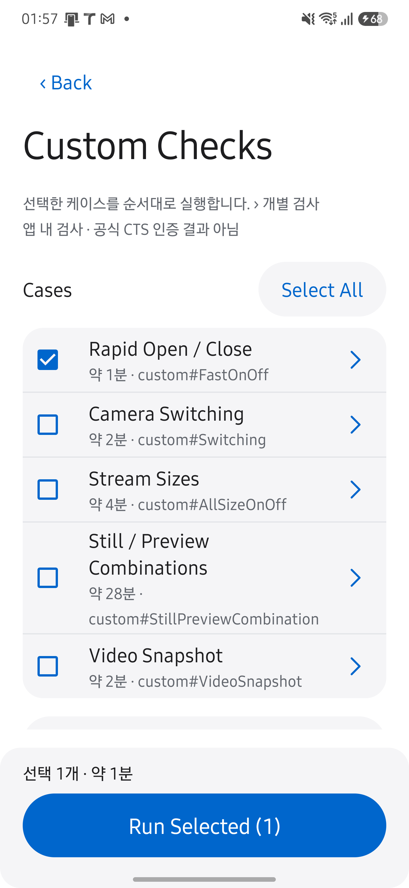
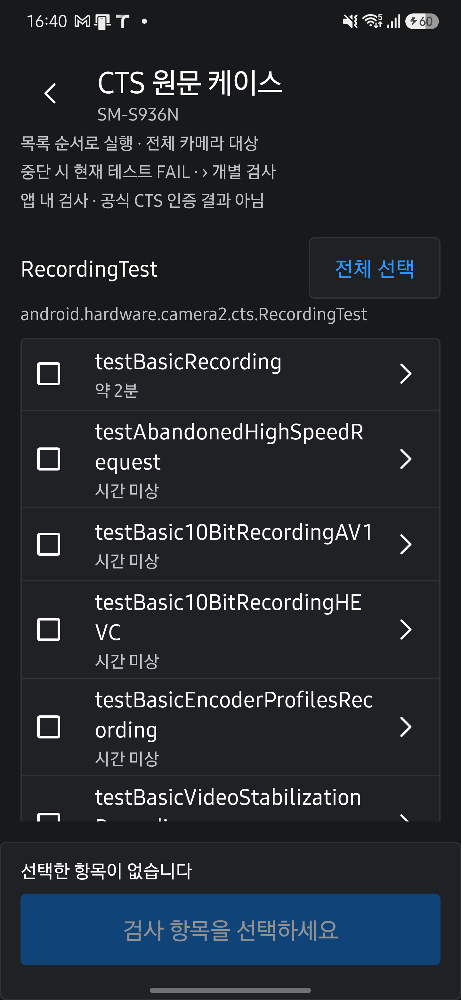
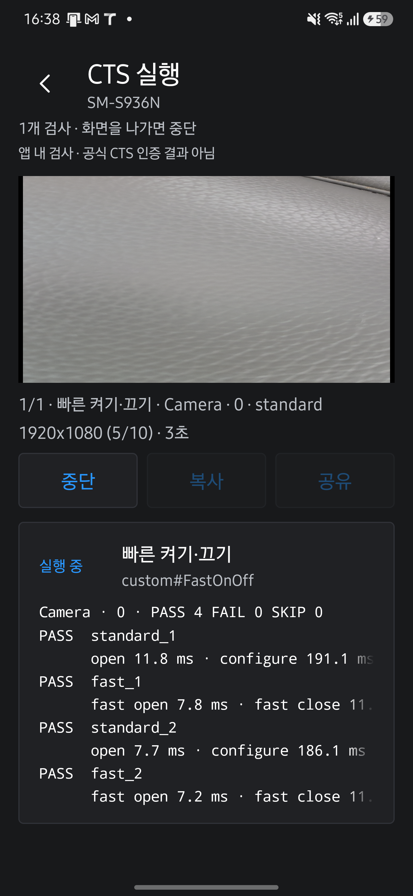
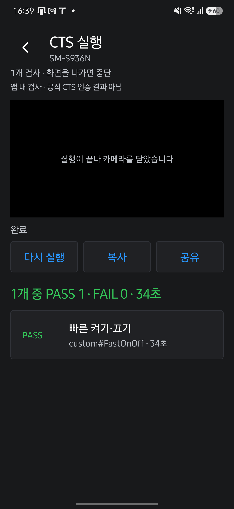

<h1 lang="en">The same test, inside the app.</h1>

지원한다고 적힌 촬영 조합은 실제로도 동작할까요.

**`Lab → CTS`에서 확인할 항목을 골라 실행해 보세요.** 카메라를 열고, 사진을 찍고, 녹화한 결과를 판정과 함께 읽습니다.

앱의 결과는 사전 점검용입니다. 공식 CTS 판정은 cts-tradefed의 `test_result.xml`로 확인합니다.

## 선택한 항목을 실행하세요

1. Live의 `Lab → CTS`를 엽니다.
2. `Custom Checks` 또는 `AOSP CTS`를 고릅니다. 원문 케이스는 **Android 14 이상**에서 사용할 수 있습니다. [방식 비교](#검사-방식의-차이)에서 차이를 확인하세요.
3. 실행할 항목을 체크합니다. 하단에서 선택 개수와 예상 시간을 확인합니다.
4. `Run Selected (선택 개수)`를 누르고 필요한 권한을 허용합니다.
5. 끝난 카드를 눌러 결과를 확인합니다.

결과에는 판정과 소요 시간이 남습니다. 실패나 SKIP은 [판정 읽기](#판정을-읽으세요)에서 확인하세요.

- **한꺼번에 선택하려면** 그룹의 `Select All`을 누릅니다. 선택은 다음에 열 때도 유지됩니다.
- **도중에 멈추려면** `Stop`을 누릅니다. 현재 항목은 `중단됨`, 나머지는 `실행 안 함`으로 남습니다.
- **결과를 가져오려면** `Copy`로 전체 보고서를 클립보드에 넣습니다. `Share`는 같은 내용을 다른 앱으로 보냅니다.
- **다시 검사하려면** `Run Again`을 누릅니다. 같은 항목을 처음부터 실행합니다.

권한·예상 시간·실행 순서

- Live의 카메라를 닫은 뒤 CTS를 엽니다.
- 카메라 권한이 필요하며 녹화 항목은 마이크 권한도 확인합니다.
- 항목마다 공개 카메라를 순회합니다. 컬러 출력이 없거나 외장 카메라이면 CTS와 같은 사유로 건너뜁니다.
- 한 항목이 카메라를 닫고 결과를 보고한 뒤 다음 항목을 시작합니다.

이력이 없는 원문 메서드의 예상 시간은 `시간 미상`입니다. 진행 중에는 단계별 결과가 추가되고, 완료 후 판정과 소요 시간이 남습니다.

항목 하나만 보려면 행의 `›`를 누릅니다. 단일 항목도 `Run`·`Stop`·`Copy`·`Share`로 조작합니다.

커스텀 케이스는 한 단계가 실패해도 나머지를 계속 실행합니다. CTS 원문은 중단 처리에 몇 초가 걸릴 수 있습니다.

## 검사 방식의 차이

- **커스텀 케이스:** CTS 규칙과 상수를 앱의 Kotlin으로 옮긴 다섯 가지 검사입니다. 카메라와 단계별로 판정합니다.
- **CTS 원문 케이스:** AOSP의 Java 테스트를 앱 안의 JUnit으로 실행합니다. 테스트 메서드 하나에 판정 하나를 냅니다.

CTS 판정과 Benchmark의 성능 저하 판정은 별개입니다.

스크린샷은 당시 빌드의 기록입니다. <a href="evidence.html#앱-화면-촬영">촬영 기기·버전·확인 범위</a>를 함께 읽으세요.

## 커스텀 케이스를 선택하세요

- **빠른 켜기·끄기:** 열고 닫는 두 순서의 첫 프레임을 비교합니다.
- **카메라 전환:** 카메라를 바꿔 열고 녹화합니다.
- **모든 크기 켜기·끄기:** 지원하는 모든 프리뷰 크기를 엽니다.
- **정지 영상 × 프리뷰 조합:** JPEG와 프리뷰 크기 조합을 검사합니다.
- **동영상 스냅샷:** 녹화하면서 사진을 한 장 찍습니다.

횟수·시간·통과 조건

**빠른 켜기·끄기** · `custom#FastOnOff`

표준 열기와 빠른 열기를 5회씩 번갈아 수행합니다.

- **표준 열기:** 열기 → 프리뷰 세션 → 첫 프레임 → 닫기 순서입니다.
- **빠른 열기:** 열기 직후 닫기 → 다시 열기 → 첫 프레임 → 닫기 순서입니다.

첫 프레임의 `SENSOR_TIMESTAMP`와 프레임 번호를 검사합니다. 마지막 줄에는 두 방식의 첫 프레임 중앙값을 비교합니다.

**카메라 전환** · `custom#Switching`

카메라를 차례로 열어 첫 프레임을 받고 닫는 전환을 5회 반복합니다.

그 뒤 카메라마다 가장 큰 CamcorderProfile로 3초 녹화합니다. 녹화는 파일·트랙·크기와 길이 오차 20 %만 검사합니다.

**모든 크기 켜기·끄기** · `custom#AllSizeOnOff`

SurfaceHolder로 보고하는 프리뷰 크기 전부를 큰 것부터 하나씩 열어 첫 프레임을 확인합니다. 1080p 상한을 두지 않습니다.

**정지 영상 × 프리뷰 조합** · `custom#StillPreviewCombination`

JPEG 크기 전부와 프리뷰 크기(1080p 이하) 전부의 조합마다 세션을 구성합니다.

프리뷰 첫 프레임 뒤 정지 영상을 한 장 찍고, 요청한 크기의 디코딩 가능한 JPEG인지 검사합니다.

`StillCaptureTest#testStillPreviewCombination`의 순서와 QCIF 예외를 따르되 AE·AF 수렴은 기다리지 않습니다.

**동영상 스냅샷** · `custom#VideoSnapshot`

가장 큰 CamcorderProfile로 25초를 녹화합니다. 5~20초 사이 무작위 시점에 같은 세션으로 JPEG 스냅샷을 한 장 찍습니다.

동영상은 `RecordingTest#testVideoSnapshot`의 프레임 드롭률 8 %(15 MP 초과 스냅샷은 12 %)를 검사합니다.

스냅샷은 크기와 디코딩을 검사합니다.

실제 화면 보기

<figure class="app-screenshot">

<figcaption>커스텀 케이스에서 빠른 켜기·끄기 한 개를 선택했습니다. 하단 실행 버튼은 선택한 항목 수를 표시합니다.</figcaption>
</figure>

커스텀 검사와 CTS 원본의 관계

`custom#` 원본은 CTS 클래스에 그대로 대응하는 메서드가 없는 케이스입니다. 검사 문구는 CTS `CameraTestUtils`에 같은 검사가 있으면 그 문구를 따릅니다.

`RecordingTest#testBasicRecording`은 CTS 원문 케이스로만 제공합니다.

녹화 판정 규칙(`BasicRecordingRules`)은 카메라 전환과 동영상 스냅샷이 공유합니다.

## CTS 원문 메서드를 선택하세요

- **`RecordingTest`:** CamcorderProfile 녹화, 동영상 스냅샷, 고속·슬로모션 녹화, 프리뷰 크기별 녹화 등 16개 메서드입니다.
- **`StillCaptureTest`:** JPEG·HEIC·RAW·DNG 촬영, AE/AF 수렴, 줌, 회전, 초점 거리, 프리뷰와 정지 영상 크기 조합, 타임스탬프 등 21개 메서드입니다.
- **`BurstCaptureTest`:** JPEG·YUV·RAW 연속 촬영의 프레임 순서와 처리량을 검사하는 3개 메서드입니다.

업스트림 본문이 TODO뿐인 `testCameraRecorderOrdering`·`testMediaCodecRecording`·`testTimelapseRecording`은 목록에서 제외합니다.

측정 이력이 없는 메서드는 `시간 미상`으로 표시합니다. `UiAutomation`이나 `@TestApi`가 필요한 메서드는 초기화 단계에서 실패할 수 있습니다.

기존 기기별 결과와 소요 시간은 [Validation](evidence.md#cts-원문-케이스)에 있습니다.

실제 화면 보기

<figure class="app-screenshot">

<figcaption>AOSP 원문 메서드 목록을 연 화면입니다. 이 장면에서는 항목을 선택하거나 원문 테스트를 실행하지 않았습니다.</figcaption>
</figure>

실제 화면 보기

<figure class="app-screenshot">

<figcaption>빠른 켜기·끄기를 실행 중인 화면입니다. 카메라 프리뷰와 현재 회차, 단계별 판정을 함께 표시합니다.</figcaption>
</figure>

## 판정을 읽으세요

**커스텀 케이스는 카메라와 단계별로 판정합니다.** PASS 행에도 시간과 수치를 남깁니다.

카메라·단계 이름 읽기

카메라는 `Camera · 0`처럼 표시하고, 단계는 다음처럼 구분합니다.

- **동영상 스냅샷:** 프로파일 이름을 표시합니다.
- **빠른 켜기·끄기:** `standard_1`·`fast_1`과 `compare`를 표시합니다.
- **카메라 전환:** `round_1`과 `record`를 표시합니다.
- **크기 케이스:** `1920x1080`처럼 크기를 표시합니다.
- **조합 케이스:** `4000x3000/1920x1080`처럼 정지 영상과 프리뷰 크기를 표시합니다.

PASS에도 소요 시간·녹화 길이·프레임 수가 남습니다. FAIL은 CTS assertion 메시지와 대조하세요.

**CTS 원문은 테스트 메서드 단위로 판정합니다.** `SKIP`은 통과했다는 뜻이 아닙니다.

- **PASS:** JUnit 실패가 없고 카메라를 하나 이상 열었습니다. 실행 조건과 측정값을 확인하세요.
- **FAIL:** 실패가 한 건 이상 있습니다. 실패 카드의 예외 메시지와 카메라 ID를 확인하세요.
- **SKIP:** assumption으로 건너뛰었거나 모든 카메라를 건너뛰어 하나도 열지 않았습니다. `건너뛴 이유`에서 미지원 기능과 조건을 확인하세요.

SKIP 이유와 로그 읽기

앱은 `openDevice` 호출 기록으로 카메라를 실제로 열었는지 확인합니다.

원문에서 모든 카메라를 `continue`로 건너뛰고 통과한 경우도 앱에서는 SKIP으로 표시합니다.

`건너뛴 이유` 카드는 다음 근거를 모읍니다.

1. assumption 메시지를 표시합니다.
2. 테스트가 남긴 “… skipping” 로그를 표시합니다.

   예를 들어 `Camera 0 does not support HEIC_ULTRAHDR, skipping`은 카메라 0이 해당 형식을 지원하지 않는다는 뜻입니다.

3. `SkipDiagnosis`가 원문의 `continue` 조건을 다시 확인한 키와 값을 표시합니다.

   HEIC UltraHDR 검사라면 `SCALER_STREAM_CONFIGURATION_MAP`에 `ImageFormat.HEIC_ULTRAHDR(0x48455548)`가 있는지와 실제 출력 형식 목록을 보여 줍니다.

모든 카메라의 이유가 같으면 한 줄로, 다르면 카메라별로 표시합니다.

업스트림 코드 자체가 카메라를 열지 않는 메서드도 이유를 남깁니다. 예를 들어 10비트 AV1 경로는 `getDynamicRangeProfile()`의 switch에 AV1 case가 없습니다.

앱은 자기 프로세스의 logcat만 읽습니다. 카메라별·프로파일별 세부 정보가 모두 남는 것은 아닙니다.

실패 카드에는 예외 메시지와 CTS 호출 위치 세 줄을 표시합니다. 어느 카메라에서 실패했는지는 메시지의 카메라 ID로 확인하세요.

검사용 동영상은 앱 전용 폴더의 `test_video.mp4`를 판정 뒤 삭제합니다. 정지 영상·스냅샷도 검사 뒤 버립니다. CTS 원문도 같은 폴더를 사용하며 앨범에는 남기지 않습니다.

실제 화면 보기

<figure class="app-screenshot">

<figcaption>이번 실행은 35초에 PASS로 끝났습니다. 이 결과는 해당 기기의 앱 내 검사 한 건이며 공식 CTS 인증 결과가 아닙니다.</figcaption>
</figure>

**다음 단계:** 같은 조건의 성능 변화는 [Benchmark](benchmark.md)에서 비교하세요.
