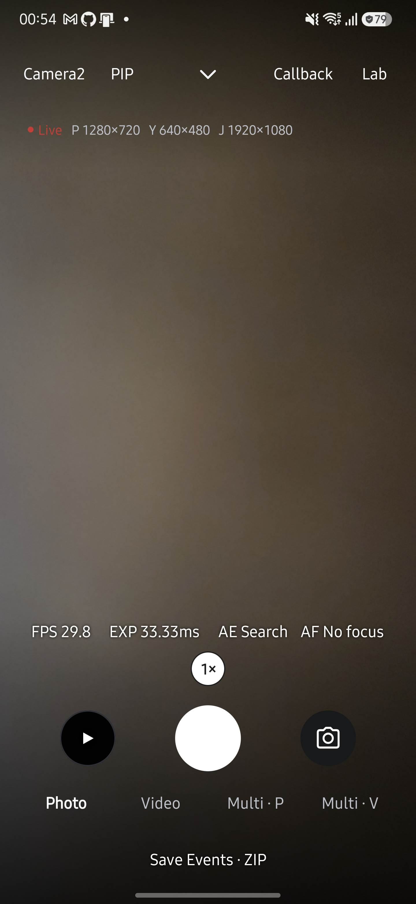
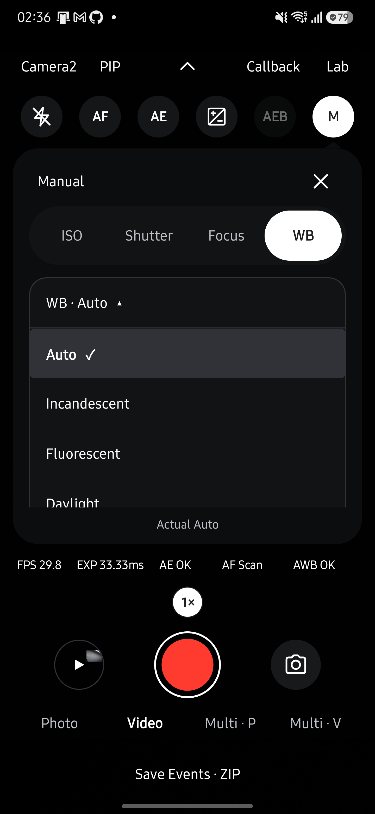

<h1 lang="en">Set. Capture. Inspect.</h1>

같은 장면도, 촬영 조건을 바꾸면 다르게 남습니다.

Photo로 한 장을 찍고, Video로 움직임을 담아 보세요. 처음에는 기본값이면 충분합니다.

- **[촬영](#live에서-촬영하세요)** · 사진·연사·AEB·동영상을 촬영합니다.
- **[App Bokeh](#앱에서-배경을-흐리세요)** · 인물이나 사물의 깊이를 추정하고 촬영 후 배경 흐림을 조절합니다.
- **[Portrait](#제조사-portrait로-배경을-흐리세요)** · Depth 메뉴에서 제조사 Bokeh 사진을 선택합니다.
- **[수동 설정](#수동-촬영-조건을-고정하세요)** · ISO·노출 시간·초점을 고정합니다.
- **[스트림 설정](#live-스트림을-설정하세요)** · 출력 크기·FPS·포맷을 바꿉니다.
- **[PIP](#pip로-보이는-구도를-저장하세요) · [Multi](#여러-카메라를-함께-촬영하세요)** · 보조 화면을 합성하거나 여러 카메라로 촬영합니다.
- **[손떨림 보정](#손떨림-보정을-선택하세요) · [초점과 노출](#초점과-노출을-조절하세요)** · 보정·AF·AE를 조절합니다.

## Live에서 촬영하세요

1. 처음에는 기본값을 유지합니다. 다른 엔진은 상단에서, 다른 카메라는 오른쪽 아래 카메라 버튼에서 고릅니다.
2. `Photo`에서 하단 가운데 셔터를 짧게 한 번 누릅니다.
3. 저장 완료 안내가 나오면 셔터 왼쪽 갤러리 썸네일을 눌러 결과를 확인합니다.

**기본 사진은 카메라가 만든 JPEG 한 장입니다.** `DCIM/HALCamera`에 저장하며, 촬영 메타데이터 JSON도 남깁니다.

[JPEG 목록](#live-스트림을-설정하세요)에서 YUV를 고르면 앱이 변환한 JPEG를 저장합니다. Camera2에서 RAW를 켜면 DNG도 저장합니다.

**모드나 엔진을 바꾸면 새 촬영으로 시작합니다.** PIP·스트림·줌·촬영 제어는 초기화됩니다. Callback의 고정 시간은 사용자 설정으로 유지합니다.

### 앱에서 배경을 흐리세요

1. `Depth → App Bokeh`를 선택합니다. 제조사 Bokeh나 센서 Depth 지원 여부와 관계없이 일반 JPEG 촬영을 사용합니다.
2. 셔터를 누릅니다. 원본을 저장한 뒤 기기 안에서 깊이를 추정합니다. LIVE 미리보기에는 이 효과가 적용되지 않습니다.
3. 편집 화면에서 선명하게 유지할 인물이나 사물을 누릅니다. 선택한 지점보다 멀다고 추정된 영역을 흐리게 처리합니다.
4. 슬라이더로 강도를 조절하고 `Bokeh`, `Original`, `Depth`로 결과를 비교합니다. 선택한 화면은 테두리와 굵은 글씨로 표시하며 강도를 바꾸면 `Bokeh` 결과로 돌아갑니다. 강도 0은 처리용 원본 픽셀을 유지합니다.
5. `Save Bokeh`를 누릅니다. 비교 중인 화면과 관계없이 보케 JPEG와 추정 깊이 PNG는 `DCIM/HALCamera`, 모델·원본 URI·선택 지점·강도 기록은 `Download/HALCamera`에 저장합니다. 촬영 원본은 변경하지 않습니다. 상단 닫기 버튼이나 시스템 뒤로 가기로 Live에 돌아갑니다.

**App Bokeh는 RGB 사진 한 장으로 상대적인 깊이를 추정합니다.** MiDaS v2.1 모바일 모델을 LiteRT CPU에서 실행하고 앱이 배경 흐림과 JPEG 인코딩을 수행합니다. 모델은 앱에 포함되며 사진을 서버로 보내지 않습니다. 깊이 맵의 흰색은 가까운 영역, 검은색은 먼 영역을 뜻하고 미터 단위 거리나 센서 DEPTH16이 아닙니다.

편집·저장 결과는 메모리 사용을 제한하기 위해 긴 변이 최대 1600픽셀입니다. 원본 해상도는 별도로 유지하며, 깊이 추론 해상도는 256×256입니다. 얇은 물체, 반사·투명 물체, 머리카락 경계나 무늬가 적은 장면에서는 깊이와 경계가 부정확할 수 있습니다. 깊이를 구분하지 못하면 실패 이유를 표시하고 원본을 유지합니다. 선택한 지점과 같은 깊이 또는 더 가까운 물체는 선명하게 남습니다.

App Bokeh는 사진 한 장씩 처리합니다. 연사·AEB·PIP·수동 제어는 제공하지 않으며, `Photo`나 `Video`를 누르면 일반 촬영으로 돌아갑니다. 화면을 다시 열면 원본에서 편집을 다시 시작하므로 저장 전 선택 지점과 강도는 초기화됩니다. [모델 출처와 빌드 절차](https://github.com/TTolsun/hal-camera/blob/main/docs/design/APP-BOKEH.md)를 참고하세요.

### 제조사 Portrait로 배경을 흐리세요

1. `Lab → Probe`에서 카메라별 `Portrait · Manufacturer Bokeh` 지원 여부와 전용 미리보기·JPEG 해상도를 확인합니다.
2. Live의 `Depth → Portrait (Bokeh)`를 선택합니다.
3. JPEG 해상도를 고릅니다. 각 항목에 함께 구성할 미리보기 해상도를 표시합니다.
4. 미리보기가 준비되면 가운데 셔터로 촬영하고, 저장 완료 뒤 갤러리에서 JPEG를 확인합니다.
5. 일반 촬영으로 돌아가려면 `Photo`나 `Video`를 누릅니다. `Depth → Off`로도 Photo로 돌아갑니다.

**Portrait는 제조사가 처리한 컬러 미리보기와 JPEG를 받는 촬영 모드입니다.** Depth 메뉴에서 선택하지만 센서 Depth 맵을 받는 기능은 아닙니다. `DEPTH_OUTPUT`이 없는 카메라도 Bokeh 확장을 제공할 수 있습니다. 이 앱의 제조사 Portrait는 Android 12 / API 31 이상에서 Camera2 확장 세션을 사용합니다.

선택하면 기존 카메라를 닫고 표시한 해상도로 세션을 엽니다. 나열된 크기라도 조합에 따라 제조사가 거절할 수 있으며, 다른 크기로 자동 대체하지 않습니다. 세션 구성 후 첫 미리보기 프레임은 15초, 촬영 요청 후 JPEG 수신은 60초까지 기다리고 실패 이유를 표시합니다. 실패 뒤에는 Depth 메뉴에서 해상도를 다시 고르거나 Photo로 돌아가세요.

Portrait에서는 동영상·RAW·YUV 사진·연사·AEB·PIP·줌·터치 측광·수동 제어를 제공하지 않습니다. 배경 흐림의 모양과 강도는 제조사가 정합니다. JPEG와 `manufacturer_bokeh` 촬영 메타데이터는 일반 사진과 같은 저장 경로에 남고 Benchmark JSON이나 진단 ZIP에 이미지 픽셀을 넣지 않습니다.

같은 모드로 Lab에서 돌아오거나 앱을 다시 표시하면 Portrait 해상도를 유지합니다. 카메라·엔진을 바꾸거나 일반 Live Streams 설정을 적용하면 Portrait를 종료합니다. 크기 표시는 일반 Live Streams 대신 Depth 선택 메뉴를 엽니다. 새 CLI 촬영 요청은 일반 Photo·Video 구성을 사용하며 Portrait를 이어받지 않습니다.

### Depth 맵을 보세요

1. `Lab → Probe`에서 카메라의 `Depth` 섹션을 확인합니다.
2. Live로 돌아와 카메라를 선택합니다.
3. 하단의 `Depth → Depth Map`에서 `DEPTH16` 해상도를 선택합니다. 지원하지 않거나 정보를 읽지 못한 카메라는 Depth 메뉴에 이유를 표시합니다.
4. 컬러 화면으로 돌아가려면 `Photo` 또는 `Video`를 누릅니다. `Depth → Off`로도 Photo로 돌아갈 수 있습니다.

**Depth는 Camera2의 깊이 맵만 표시하는 보기 모드입니다.** 선택하면 기존 카메라를 닫은 뒤 Depth 전용 세션을 엽니다. 컬러와 Depth를 같은 요청에서 받을 수 없는 기기에서도 사용할 수 있으며, 컬러와 정렬된 합성 화면은 제공하지 않습니다. 사진·동영상 저장, 줌·터치 측광·수동 제어와 PIP는 사용할 수 없습니다.

가까운 곳은 밝고 먼 곳은 어둡습니다. 표시 범위는 0–8.191 m이며, 거리가 0이거나 신뢰도가 50% 미만인 픽셀은 검게 표시합니다. 중앙 거리와 유효 픽셀 비율도 표시합니다. 비율은 화면에 표시할 표본을 기준으로 계산합니다. 표시용 맵은 긴 변이 최대 640픽셀이 되도록 표본을 추출하며, 갱신은 최대 초당 10회입니다.

선택한 해상도로 세션을 열지 못하거나 8초 동안 첫 Depth 프레임을 받지 못하면 이유를 표시합니다. 이때 다른 해상도를 선택하거나 `Photo`로 돌아가세요. 맵은 센서 방향과 전면 카메라의 좌우 반전을 반영하며 전체 영역을 잘라내지 않고 보여줍니다. Depth 픽셀을 Benchmark JSON이나 진단 ZIP에 저장하지 않습니다.

### 동영상을 찍으세요

1. 하단에서 `Video`를 선택합니다.
2. 빨간 셔터로 녹화를 시작합니다.
3. 프리뷰를 두 손가락으로 확대하거나 줌 버튼을 눌러 구도를 바꿉니다.
4. 같은 셔터로 녹화를 끝내고 저장 완료 안내를 확인합니다.

Photo와 PIP에서도 같은 방식으로 확대하며, PIP의 줌은 메인 카메라에 적용됩니다.

- **RAW/DNG** · Photo: 지원되는 Camera2에서 선택합니다. Video: 사용할 수 없습니다.
- **손떨림 보정** · Photo: Off로 고정합니다. Video: 기기가 지원하는 모드를 선택합니다.

저장 완료 뒤 다음 촬영을 시작하세요. 실패 안내는 화면에 남습니다.

### 녹화 중 조작

녹화 중에는 셔터 아래에 경과 시간이 표시됩니다. 줌은 계속 바꿀 수 있지만 엔진·카메라·모드 변경, 일시정지, 갤러리와 다른 도구 진입은 제한됩니다.

정지·저장이 끝나면 VIDEO 스트림을 다시 준비합니다. 준비가 끝나면 다음 녹화를 시작할 수 있습니다.

### 녹화 중 사진을 찍으세요

1. 동영상 녹화를 시작합니다.
2. 큰 셔터 **오른쪽의 사진 버튼**을 누릅니다. 큰 셔터는 녹화를 끝내는 버튼입니다.
3. 저장 완료를 기다립니다. 저장하는 동안에는 다음 사진을 찍을 수 없습니다.

**저장 결과:** 선택한 JPEG 소스에 따라 카메라 JPEG 또는 YUV에서 변환한 JPEG 한 장을 저장합니다.

[PIP는 합성 결과](#pip로-보이는-구도를-저장하세요), [Multi는 카메라별 원본](#여러-카메라를-함께-촬영하세요)을 저장합니다. 사진이 실패해도 녹화는 계속됩니다.

사진 버튼이 흐리면 눌러 이유를 확인하세요. 일반 녹화에서는 JPEG가 Off이거나 기기가 녹화와 선택한 스냅샷 출력 조합을 지원하지 않으면 사용할 수 없습니다.

일반 녹화의 JPEG 목록에서 YUV를 고르면 현재 YUV 크기를 사용합니다. PIP 사진은 PHOTO와 같은 합성 해상도를 사용합니다.

CameraX에서는 사진 촬영 때 영상의 프레임 간격이 늘어날 수 있습니다.

녹화 연속성이 중요하면 [엔진별 제약과 검증 조건](engine.md#녹화-중-사진의-알려진-제약)을 먼저 확인하세요.

### 화면에서 바로 읽는 정보

`FPS · EXP · AE · AF · AWB`는 현재 프레임 속도, 노출 시간, 자동 노출·초점·화이트 밸런스 상태입니다.

`EXP 10.00ms`는 노출 시간이 10ms라는 뜻입니다.

상단 화살표를 펼치면 Live·스트림 크기 대신 제어 버튼이 나옵니다.

`M`·`EV`·`Flash`는 누른 버튼 아래로 열리며, 같은 버튼이나 화살표로 닫습니다. 활성 설정은 실시간 정보 아래에서 확인합니다.

Callback 그래프를 켜면 정보 줄은 잠시 숨깁니다.

<figure class="app-screenshot" id="screen-live">

<figcaption>Camera2의 사진 모드입니다. 하단에서 실시간 정보, 줌, 셔터와 최근 썸네일을 확인할 수 있습니다. Galaxy S25+ · Android 16 · 2026-10-11</figcaption>
</figure>

### 연사

1. 사진 모드에서 AEB를 끄고 셔터를 길게 누릅니다.
2. 원하는 만큼 찍었으면 손을 뗍니다.
3. 저장한 장수와 실패 안내를 확인합니다.

손을 뗄 때 이미 시작한 사진은 저장하고, 다음 사진은 찍지 않습니다.

TalkBack에서는 `Start burst`로 시작하고 셔터의 `Stop burst`로 멈춥니다.

촬영 속도·중단 조건·파일 식별자

- 앞 장의 저장이 끝나면 다음 장을 찍습니다. 장수나 간격은 고르지 않으며 카메라와 저장이 허용하는 속도로 촬영합니다.
- 한 번에 최대 50장입니다. 한 장이 실패해도 계속하지만 두 장 연속 실패하면 멈춥니다.
- 각 장은 일반 사진과 같은 파일로 저장합니다. 메타데이터 JSON의 `requestId`(`burst-<시각>-01` 형식)로 같은 연사인지 구분합니다.

### AEB

1. 상단 제어 줄에서 [AEB](glossary.md#aeb)를 켭니다.
2. 셔터를 한 번 누릅니다. AEB가 켜져 있으면 길게 눌러도 일반 연사로 바뀌지 않습니다.
3. 셔터 위의 진행 장수와 HDR 저장 결과를 확인합니다. 중단하려면 흰 정지 사각형으로 바뀐 셔터를 누릅니다.

**저장 결과:** 현재 EV, 2 EV 어둡게, 2 EV 밝게 원본 3장을 촬영합니다. 합성 조건을 충족하면 `_AEB_HDR.jpg`도 저장합니다.

수동 노출·동영상 모드·PIP 합성·EV 미지원 카메라에서는 AEB를 사용할 수 없습니다. 움직이는 물체는 합성 이미지에 겹쳐 보일 수 있습니다.

촬영 중에는 EV·수동 제어·줌·터치 측광을 잠그고, 끝나면 원래 EV로 돌아갑니다. 다음 AEB는 `HDR…` 합성이 끝난 뒤 시작합니다.

합성에는 카메라 또는 YUV 앱 변환 JPEG 3장이 필요합니다. RAW만 저장하면 합성하지 않습니다.

- **`HDR saved`** · 합성 이미지가 저장됐습니다.
- **`HDR skipped`** · 함께 표시된 저장 장수·중단·실패 결과를 확인하세요. 원본 3장이 모두 저장되지 않아 합성을 시작하지 않았습니다.
- **`HDR skipped: no JPEG output`** · 합성에 필요한 JPEG 파일이 없어 시작하지 않았습니다.
- **`HDR failed`** · 합성을 시도했으나 실패했습니다. 이미 저장한 원본은 유지됩니다.

실제 노출·원본 파일·합성 조건 자세히 보기

카메라의 EV 범위를 넘는 요청은 범위 끝으로 맞춥니다. 각 장의 EV를 바꾼 뒤 0.5초 기다리고 촬영합니다.

이 대기는 AE가 따라왔는지 확인하지 않으므로 실제 노출은 메타데이터 JSON의 노출 시간과 ISO로 확인합니다.

요청한 EV는 `requestId`(`bracket-<시각>-2-ev-2.0` 형식)에 남습니다.

원본 파일 이름에는 순서와 EV가 붙습니다(`_AEB2_EV-2.0_JPEG.jpg`). 합성 이미지의 메타데이터 JSON에는 사용한 원본이 기록됩니다.

갤러리에서는 `AEB −2.0 · JPEG`, `AEB · HDR` 표시로 구분합니다.

합성은 촬영 뒤에 진행하므로 그동안에도 카메라를 쓸 수 있습니다. 세 장 사이에 움직인 물체를 정렬하지는 않습니다.

연사 속도와 실제 노출 차이는 기기와 장면에 따라 달라집니다.

[연사·AEB 검증 기록](evidence.md#연사와-aeb)에서 확인한 조건과 범위를 확인하세요. 해당 기록은 HDR 합성 검증을 포함하지 않습니다.

## 추가 설정

**첫 촬영을 마쳤다면 필요한 설정만 골라 보세요.** 기본 촬영에는 아래 설정을 모두 읽을 필요가 없습니다.

### 수동 촬영 조건을 고정하세요

수동 촬영 설정

**Camera2에서만 사용할 수 있습니다.** 상단 화살표를 펼치고 `M`을 눌러 Manual 패널을 여세요. 닫은 뒤에도 설정은 실시간 정보에 표시됩니다.

#### ISO와 노출 시간을 고정하세요

1. `ISO` 또는 `Shutter`에서 `Manual`을 선택합니다. 현재 ISO와 노출 시간이 함께 고정됩니다.
2. 슬라이더로 값을 조절합니다. 숫자를 누르면 직접 입력할 수 있습니다. 노출 시간은 ms 또는 `1/125` 형식을 사용합니다.
3. 패널 아래의 실제 적용값을 확인합니다. 지원 범위를 벗어나면 값 조정 안내나 입력 오류가 표시됩니다.

#### 초점과 화이트밸런스를 바꾸세요

- **초점:** `Focus → Manual`에서 diopter 단위로 조절합니다.
- **WB:** `WB → WB 값 버튼`에서 프리셋을 고릅니다.
- **닫기:** 설정은 유지됩니다. 뒤로 가기는 열린 WB 목록부터 접습니다.
- **Reset:** 노출·초점·WB를 모두 자동으로 되돌립니다.

패널 아래 `Actual`은 카메라가 보고한 적용값입니다. 다시 Auto를 고르면 WB만 자동으로 돌아갑니다.

<figure class="app-screenshot" id="screen-wb-inline">

<figcaption>WB 목록은 버튼 아래로 이어집니다. 아래 항목은 목록을 스크롤해 고르세요. Galaxy S25+ · Android 16 · 2026-10-11</figcaption>
</figure>

카메라·엔진·촬영 모드·스트림 구성을 바꾸면 수동 설정이 초기화됩니다. 같은 모드의 프리뷰·촬영에는 같은 설정을 적용합니다.

수동 설정의 제한과 고급 WB

- 수동 노출에서는 AE 잠금·EV·자동/강제 플래시를 사용할 수 없습니다. torch는 지원 기기에서 유지됩니다.
- 수동 초점에서는 화면을 터치해도 자동 초점으로 돌아가지 않습니다.
- 노출 시간은 현재 FPS와 센서 범위로 제한합니다. Auto FPS에서는 30fps를 요청하지만 출력 조합에 따라 실제 FPS가 달라질 수 있습니다.
- 수동 WB gains와 3×3 matrix는 해당 기능을 지원하는 기기의 수동 노출에서 사용합니다. Kelvin 값으로 변환하지 않습니다.
- Live의 수동 설정은 Benchmark 실행 조건에 영향을 주지 않습니다.

### Live 스트림을 설정하세요

스트림 설정

1. Live 옆의 크기 표시를 누릅니다. `Lab → Settings → Live Streams`에서도 열 수 있습니다.
2. 아래 목록에서 바꾸려는 출력의 조건을 선택합니다.
3. `Apply`를 눌러 적용합니다. 뒤로 가기는 변경을 저장하지 않습니다.
4. Live 상단의 크기 표시에서 적용 결과를 확인합니다.

- **프리뷰** · Preview 크기를 선택합니다.
- **FPS**

  PHOTO는 프리뷰의 Auto·지원 범위, 일반 VIDEO는 녹화 포맷·해상도에 맞는 프레임률을 선택합니다.

  PIP VIDEO는 30fps 고정이며 카메라는 Auto입니다. CameraX PIP PHOTO는 Auto입니다.
- **JPEG 출처** · JPEG 목록의 `YUV (현재 크기)`는 앱에서 변환하고, 해상도 선택은 카메라 JPEG를 저장합니다. `Off`는 JPEG 저장을 끕니다.
- **YUV·RAW** · YUV는 분석 스트림 크기입니다. YUV만 켜면 사진을 저장하지 않습니다. RAW는 Photo 모드의 지원되는 Camera2에서 DNG로 저장합니다.
- **PIP**

  보조 카메라 선택 후 `PIP Preview`와 `PIP Photo` 크기를 고릅니다. `Auto`는 지원 조합을 조회합니다.

  사진 입력 형식은 메인 JPEG 출처를 따릅니다.
- **녹화**

  VIDEO에서 Format·Resolution을 고르면 FPS 후보도 갱신됩니다. PHOTO에서는 녹화 항목이 비활성화됩니다.

  PIP는 H.264·30fps·합성 크기로 고정됩니다. CameraX 일반 녹화의 포맷은 Auto입니다. 고속 세션은 제공하지 않습니다.

지원하지 않는 개별 설정은 이유를 표시하고 Apply를 비활성화합니다. **실제 구성에 실패하면** `이전 설정으로 복원`을 누르세요.

이 버튼은 실패했을 때만 나타납니다. 개별 크기를 지원해도 여러 출력의 조합은 거부될 수 있습니다.

JPEG 해상도와 `YUV (현재 크기)`로 각각 찍어 변환 결과를 비교할 수 있습니다. 두 사진의 시점과 해상도가 같다고 가정하지 마세요.

일반 사진에서 JPEG와 RAW를 모두 끄면 셔터가 비활성화됩니다. PIP 합성 JPEG는 별도입니다.

설정은 현재 카메라·엔진에 적용되며 모드·엔진 전환 때 초기화됩니다. Benchmark의 profile은 바꾸지 않습니다.

P·Y·J·RAW·R 표시 읽기

- **P / Y:** 프리뷰 / YUV 분석 출력입니다.
- **J / J YUV:** 카메라 JPEG / 앱 변환 사진입니다.
- **RAW / R:** 센서 원본 / 녹화 출력입니다. R에는 H264·HEVC·Auto 포맷도 표시합니다.

꺼진 스트림은 표시하지 않습니다. PIP 보조 출력은 두 번째 줄에 `PIP`를 한 번 쓰고 P·Y·J 크기를 나열합니다. 합성 파일 크기는 생략합니다.

엔진별 지원 범위는 [Engine Comparison](engine.md#두-엔진의-차이)을 확인하세요.

### PIP로 보이는 구도를 저장하세요

**PIP는 한 화면으로 합성하고, Multi는 장치별로 저장합니다.** 예를 들어 후면 장면에 전면 영상을 작게 넣어 한 장으로 남기려면 PIP를 사용합니다.

1. API 버튼 옆의 `PIP`를 누릅니다.
2. 보조 카메라 하나를 고릅니다. 선택창이 닫히고 현재 Live 안에 보조 영상이 나타납니다.
3. 보조 영상을 원하는 자리로 드래그한 뒤 기존 셔터로 촬영합니다.

- **Photo · JPEG On** · 합성 JPEG 한 장과 두 카메라 원본 JPEG를 저장합니다.
- **Photo · JPEG Off** · 합성 JPEG 한 장을 저장합니다.
- **Video** · 합성 MP4 한 개를 저장합니다. 녹화 중 사진도 위의 JPEG On·Off에 따라 합성과 원본을 저장합니다.

화면의 버튼과 라벨은 파일에 들어가지 않습니다. 끄려면 `PIP → Turn off PIP`를 선택합니다.

그래프에서 원본을 찾으려면 [PIP Callback](callback.md#pip를-켜면-무엇이-추가되나요)을 확인하세요.

- **후보:** 지원 불가가 확인된 회색 항목은 선택할 수 없습니다. 크기·출력 설정을 바꾸고 다시 열면 재검사합니다. CameraX Physical 후보는 `Camera2 only`입니다.
- **Not verified:** 조회하지 못한 후보입니다. 선택은 가능하지만 실제 구성에서 실패할 수 있습니다.
- **위치:** 같은 모드의 카메라 변경·Off/On 뒤에도 유지합니다. 모드·엔진 전환 때 초기화됩니다.
- **DNG:** Camera2 Photo에서 RAW를 켜면 메인 원본 DNG와 JSON도 저장합니다. 보조 영상은 합성하지 않습니다.

PIP는 Android 11 이상과 해당 조합의 지원이 필요합니다. 플래시는 Off·Torch이며 AEB는 지원하지 않습니다.

엔진별 재구성과 저장 해상도

Camera2 Single은 현재 Live CameraDevice를 유지합니다.

다른 Service ID는 그 장치만 추가로 열고 Physical ID는 현재 장치의 출력을 추가합니다.

CameraX는 메인 ID를 유지하면서 단일·동시 use case를 다시 bind합니다. 두 엔진의 후보 목록은 같지 않을 수 있습니다.

합성 사진은 화면용 해상도이며 원본 JPEG 크기 선택과 별개입니다.

Live Streams의 PIP Preview는 합성 입력, PIP Photo는 보조 원본 크기입니다. 명시한 크기는 자동 대체하지 않습니다.

CameraX는 라이브러리 공통 동시 출력 제한과 HAL 조회를 함께 적용합니다. PIP를 끄면 일반 스트림 설정으로 복귀합니다.

원본과 합성 사진의 촬영 시각은 같다고 보장하지 않습니다.

### 여러 카메라를 함께 촬영하세요

**한 번 눌러 앞과 뒤를 각각 남겨 보세요.** `Multi · P`는 카메라별 사진, `Multi · V`는 카메라별 영상을 저장합니다.

Split으로 화면을 나눠도 파일에는 자기 카메라의 영상만 들어갑니다.

1. 하단에서 `Multi · P` 또는 `Multi · V`를 엽니다.
2. `Split`을 누릅니다. 위에서 내려오는 창에서 카메라 조합을 고르고 `Apply`를 누릅니다.
3. 가운데 셔터로 촬영하거나 녹화를 시작·종료합니다.
4. 왼쪽 갤러리에서 카메라별 파일을 확인합니다.

Split 설정은 `Apply`로 적용하며, 닫으면 기존 설정을 유지합니다. 지원하지 않는 조합은 `Unavailable combinations`에서 확인하세요.

Multi는 Android 11 이상과 독립 장치의 동시 실행 지원이 필요합니다.

Camera2와 CameraX를 선택할 수 있으며 Manual·AEB는 제공하지 않습니다. 플래시는 Off·Torch입니다.

Multi V는 마이크 권한을 받아 소리를 녹음하고, 같은 마이크의 소리를 카메라별 MP4에 넣습니다.

권한이 없거나 녹음이 실패하면 무음으로 저장하지 않고 오류를 표시합니다. 센서 동기 촬영은 보장하지 않습니다.

영상과 소리는 캡처 시각으로 정렬하지만 완전히 같은 순간의 재생을 보장하지는 않습니다.

기기별 오차와 시험 범위는 [0.29.1 검증 기록](https://github.com/TTolsun/hal-camera/blob/main/docs/validation/release-0.29.1.md)을 참고하세요.

장치 수·배치·재구성

- **한 카메라를 조절합니다.** · 분할 화면의 이름을 누릅니다. 그 장치의 줌·AF·AE·EV를 조절합니다.
- **카메라별 FPS·노출을 봅니다.**

  각 화면의 `FPS`와 `EXP`를 확인합니다. 배치가 바뀌어도 해당 카메라를 따라갑니다.
- **화면 위치를 바꿉니다.**

  이름을 꾹 누른 채 끌고, 놓일 자리의 안내가 보이면 손을 뗍니다. 화면 배치만 바뀌며 저장 파일은 유지됩니다.
- **두 카메라의 콜백을 비교합니다.**

  `Callback`을 켠 뒤 분할 화면의 이름을 눌러 장치를 바꿉니다. Callback을 켠 동안에는 화면별 FPS·EXP를 숨깁니다.
- **카메라별 크기를 바꿉니다.**

  상단의 `1 · P …`, `2 · P …` 크기 표시를 누릅니다. 카메라마다 Preview·JPEG 크기를 고르고 `Apply`를 누릅니다.
- **녹화하며 사진을 남깁니다.** · 오른쪽 사진 버튼을 누릅니다. 각 카메라의 원본 JPEG를 저장하며 녹화는 계속됩니다.
- **저장 결과를 확인합니다.**

  사진·영상은 `DCIM/HALCamera`, 사진 묶음 JSON은 `Download/HALCamera`에 있습니다.

  `Details`는 장치별 성공·실패를 보여줍니다.

카메라 이름을 원하는 방향으로 끌면 `Release` 안내가 놓일 자리를 보여 줍니다. 화면 가장자리까지 끌 필요는 없습니다.

왼쪽·오른쪽은 좌우로, 위·아래는 위아래로 나누며 끈 화면이 그쪽 절반을 차지합니다. 카메라가 3개 이상이면 대각선으로 끌어 격자의 모서리 칸을 고릅니다.

손을 놓기 전에 시작 위치 가까이 되돌리면 기존 배치를 유지하며, 두 손가락 입력이나 터치 취소도 배치를 유지합니다.

화면 낭독기에서는 이름의 `Move to left`·`Move to right`·`Move to top`·`Move to bottom` 동작으로 같은 배치를 만듭니다.

실제 장치 조합은 기기의 동시 세션 검사에 따라 거부될 수 있으며, 지원하지 않는 조합을 자동으로 대체하지 않습니다.

`Cameras`는 기기가 광고한 동시 조합에서 촬영할 카메라 수를 정합니다.

사진 크기는 장치의 JPEG 스트림, 영상 크기는 프리뷰 크기와 센서 회전에서 정합니다. 패널 크기와 저장 크기는 별개입니다.

크기 창은 동시 촬영이 보장되는 범위(Preview 1280×720 이하, JPEG 1920×1440 이하)의 크기만 보여 주며, 크기를 바꾸면 세션을 다시 구성합니다.

CameraX에서는 CameraX가 광고한 동시 카메라 조합을 사용하며 최대 두 대를 지원합니다.

지원하지 않는 조합이나 크기는 오류를 표시하고 다른 엔진이나 크기로 자동 대체하지 않습니다.

장치 조합을 바꾸면 전체 세션을 닫고 다시 구성합니다. 배치와 화면 순서만 바꾸면 기존 세션을 유지합니다.

Split 창의 `Screen` 번호는 지금 화면에 놓인 순서이며, 화면 이름 앞의 번호와 같습니다. 닫기·뒤로 가기는 Split 설정 초안을 버립니다.

녹화·촬영 중에는 Split 설정과 화면 끌기를 사용할 수 없습니다. Live로 돌아갈 때에는 모든 장치와 출력의 종료를 기다립니다.

### 손떨림 보정을 선택하세요

손떨림 보정 설정

1. 촬영·녹화를 끝내고 Live Streams를 엽니다.
2. VIDEO 모드에서 Stabilization의 Mode를 선택합니다. PHOTO 모드에서는 Off로 고정되어 선택할 수 없습니다.

   두 엔진 모두 Auto·Off와 지원되는 보정 모드를 표시합니다. CameraX의 EIS (Video)는 녹화 중에 적용됩니다.
3. `Apply`를 눌러 프리뷰를 재개합니다. Auto는 카메라 요청 템플릿의 기본값으로 복귀합니다.
4. Live 상단의 크기 표시 옆에서 실제 보정 모드를 확인합니다. 보정 표시를 누르면 설정을 다시 열 수 있습니다.

- **EIS: V** · 동영상 보정 모드입니다.
- **EIS: P, V** · 프리뷰와 동영상 보정 모드입니다.
- **EIS: ?** · 적용 상태를 확인할 수 없습니다.
- **주황색 요청값·결과값** · 요청과 다른 모드가 1초 이상 보고됐습니다.
- **표시 없음** · 보정이 정상적으로 미적용된 상태에서는 표시를 숨깁니다.

이 표시는 카메라의 결과 메타데이터입니다. 실제로 흔들림이 얼마나 줄었는지를 측정한 값은 아닙니다.

### 초점과 노출을 조절하세요

초점·노출 조절

상단 가운데 화살표로 제어 줄을 펼칩니다. 선택한 Flash·AF·AE와 EV는 제어 줄을 접어도 유지됩니다.

AF·AE 잠금은 같은 버튼으로 해제하고, 플래시는 `Off`로, EV는 눈금 옆 `0`으로 초기화합니다. 카메라나 엔진을 바꾸면 제어가 기본값으로 돌아갑니다.

- **프리뷰를 짧게 터치합니다.**

  해당 지점에 초점을 맞춥니다. 모서리 사각형이 초록색이면 성공, 빨간색이면 실패입니다.

  5초 뒤 전체 화면 기준으로 돌아가며, AF 잠금이 켜져 있으면 잠금을 풀 때까지 유지합니다.
- **프리뷰를 길게 누릅니다.** · 해당 지점을 기준으로 AE를 잠급니다. 원 위의 자물쇠와 AE 버튼으로 잠금 상태를 확인합니다.
- **다른 지점을 짧게 터치하거나 AE 버튼을 누릅니다.** · 터치로 설정한 AE 잠금을 해제합니다.

`AE Locked`는 노출 잠금, `AF No focus`는 초점이 맞지 않은 상태입니다. AF 잠금 여부는 별도의 `AF Lock` 표시로 확인하세요.

촬영 지연이나 노출 변화가 예상과 다르면 [Troubleshooting](troubleshooting.md#앱과-프레임워크hal을-구분하세요)을 확인하세요.

**다음 단계:** [Callback](callback.md)에서 촬영 프레임의 콜백과 시각을 확인하세요.
