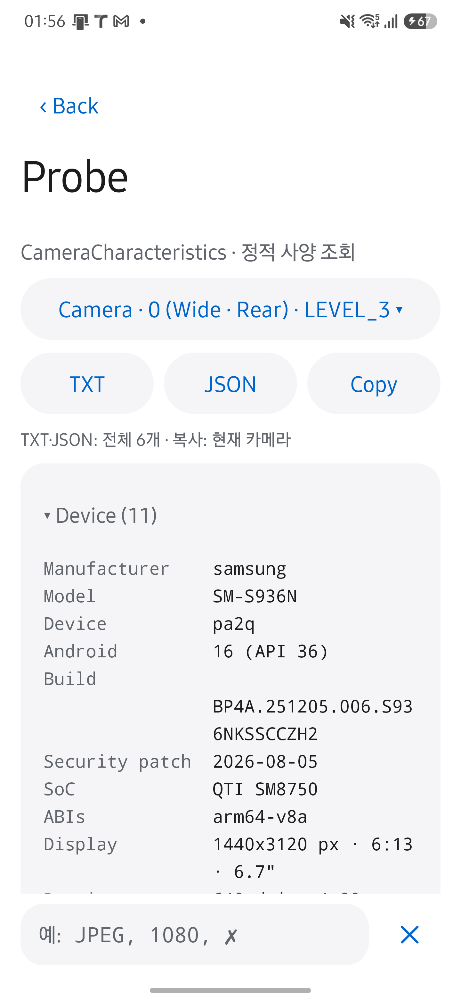

<h1 lang="en">What the HAL claims.</h1>

이 카메라는 어떤 출력을 지원한다고 말할까요.

**`Lab → Probe`에서 카메라와 찾을 사양을 고르세요.** 출력 크기부터 센서와 렌즈 정보까지, 카메라가 공개한 지원 값을 살펴봅니다.

사양을 읽는 일은 실제 동작을 검사하는 일과 다릅니다. Probe에서는 공개된 값을 확인하고, 출력 조합의 동작은 [CTS](cts.md)로 확인하세요.

## 앱에서 Probe를 여세요

1. Live에서 `Lab → Probe`를 엽니다.
2. 확인할 카메라를 선택합니다. 처음에는 Live에서 고른 카메라가 표시됩니다.
3. 필터에 `JPEG`처럼 찾을 단어를 입력하고 결과를 누릅니다.

선택한 카메라의 사양과 지원 값이 표시됩니다. 읽지 못한 항목은 실패 목록에 남습니다.

다른 검사를 하려면 Lab으로 돌아갑니다.

**읽기 실패는 미지원 판정이 아닙니다.** 실패 항목과 내보낸 JSON을 보존하세요.

실패가 반복되면 [재현 자료](troubleshooting.md#문제-발생-시-수집할-정보)를 함께 기록하세요.

아래 화면은 2026년 9월 29일 Galaxy S25+·Android 16에서 HAL CAMERA 0.15.0을 실행해 촬영했습니다. <a href="evidence.html#앱-화면-촬영">촬영 조건과 확인 범위</a>를 함께 확인하세요. 이미지를 누르면 원본이 열립니다.

<figure class="app-screenshot" id="screen-probe">

<figcaption>카메라 0을 선택하고 Device 영역을 펼쳤습니다. 제조사·모델·Android·SoC와 선택 카메라의 LEVEL_3 선언을 확인할 수 있습니다.</figcaption>
</figure>

## 사양 표를 읽으세요

찾는 값이 있다면 필터로 좁히고, 값이 속한 섹션을 함께 읽어 보세요.

- **카메라 목록:** 논리 카메라와 그 안의 물리 카메라를 구분합니다. 사양이 보여도 단독으로 열 수 없는 물리 카메라가 있습니다.
- **섹션:** 제목을 눌러 접거나 펼칩니다. 출력 형식별 크기는 STREAMS에서 확인합니다.
- **필터:** 단어가 들어간 줄을 찾습니다. 결과를 누르면 해당 항목으로 이동합니다.
- **읽지 못한 항목:** 실패 목록과 내보낸 파일에서 누락 내용을 확인합니다.
- **REQUEST · RESULT KEYS / SESSION KEYS:** 요청·결과에서 지원하는 key 이름입니다. 실제 촬영값은 아닙니다.

섹션 이름과 API별 표시 조건

IDENTITY, CAPABILITIES, SENSOR, LENS, CONTROL, PROCESSING, REQUEST 뒤에 REQUEST · RESULT KEYS가 나옵니다.

SESSION KEYS는 API 28 이상, MANDATORY STREAM COMBINATIONS는 API 29 이상에서 표시합니다.

STREAMS는 PRIVATE·JPEG 같은 출력 형식별로 나뉩니다. 이어서 HIGH SPEED VIDEO, REPROCESSING INPUTS, ALL CHARACTERISTICS가 나옵니다.

enum 값은 가능한 경우 숫자 대신 상수 이름을 표시합니다.

## 사양을 내보내세요

같은 기기의 빌드 전후를 비교하거나, 다른 기기의 HAL이 무엇을 공개하는지 나란히 보고 싶다면 JSON을 남겨 보세요.

- **`TXT`와 `JSON`:** 모든 카메라의 사양을 파일로 공유합니다.
- **`Copy`:** 현재 카메라만 클립보드에 넣습니다.

내보낸 사양에는 이미지 픽셀이 포함되지 않습니다.

Benchmark 결과 JSON과는 별개 파일이며 자동으로 연결되지 않습니다.

**다음 단계:** 사양 표에서 본 스트림 조합이 실제로 열리고 판정을 통과하는지 [CTS](cts.md)로 확인하세요.
