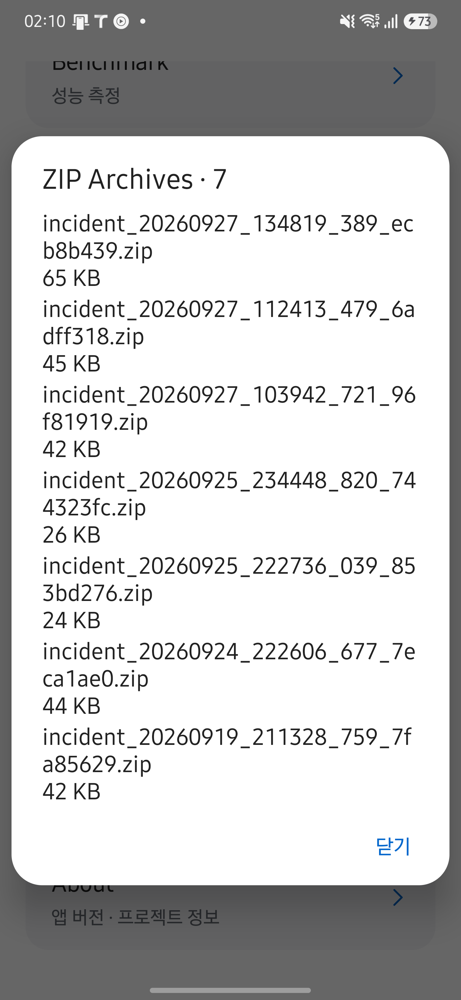

<h1 lang="en">Trace the cause.</h1>

예상과 다른 결과가 나왔다면, 같은 조건의 기록부터 살펴보세요.

**문제 직후 진단 ZIP부터 저장하세요.** 아래에서 증상에 맞는 항목을 고릅니다.

- **프리뷰나 출력 구성이 실패한다면** [Live 스트림 설정](live.md#live-스트림을-설정하세요)에서 요청한 조합과 오류를 확인하세요.
- **Callback 값이 비어 있다면** [관측 가능 여부와 대기 상태](#callback에-값이-없을-때)를 구분하세요.
- **사진이 없거나 노출이 다르다면** [저장 포맷과 엔진별 조건](#사진-저장이나-노출이-예상과-다를-때)을 확인하세요.
- **실행 기록이나 CSV가 예상과 다르다면** [필터와 결과 조건](#실행-기록과-csv의-개수가-다를-때)을 확인하세요.
- **PC 명령이 끝나지 않는다면** [기존 요청의 상태](#cli-작업이-끝나지-않을-때)를 조회하세요.

## 문제 발생 시 수집할 정보

1. **문제 직후** Live의 `Save Events · ZIP`을 누릅니다. 직전 10초의 기록을 놓치지 않도록 먼저 저장하세요.
2. 저장이 끝나면 `Lab → ZIP Archives`에서 ZIP을 공유합니다.
3. 기기 모델·Android 빌드·설치된 앱 버전과 엔진·카메라·출력 크기·FPS·촬영 설정을 기록합니다.
4. 재현 절차와 전체 시도 중 문제가 발생한 횟수를 기록합니다.

## 로그와 진단 자료

ZIP에는 직전 10초와 이후 5초의 이벤트·메타데이터가 들어갑니다. 이미지 픽셀은 포함하지 않습니다.

사진 자체가 필요하면 갤러리에서 별도로 공유하세요.

스크린샷은 당시 빌드의 기록입니다. <a href="evidence.html#앱-화면-촬영">촬영 기기·버전·확인 범위</a>를 함께 읽으세요.

<figure class="app-screenshot" id="screen-incident-history">

<figcaption>Lab → ZIP Archives에서 기기에 저장된 incident 목록을 열었습니다. 기존 기록을 조회한 화면이며 이 촬영에서 ZIP 생성이나 공유를 실행하지 않았습니다.</figcaption>
</figure>

## 앱과 프레임워크·HAL을 구분하세요

같은 카메라·출력 조건에서 진단 ZIP과 시스템 자료를 비교하세요. 콜백 간격만으로 HAL 내부 처리 시간이나 프레임 드롭을 확정할 수는 없습니다.

표본 부족과 관측 불가도 기기 고장을 뜻하지 않습니다.

## Callback에 값이 없을 때

현재 엔진과 Android 버전, 선택한 스트림을 확인하세요.

`No callback`은 관측할 수 없는 경로입니다. 아직 데이터를 기다리는 `Awaiting data`와 다릅니다.

[Callback](callback.md)에서 상태별 의미를 확인하세요.

## 사진 저장이나 노출이 예상과 다를 때

앱에서 변환한 YUV 사진이 필요하면 JPEG 목록에서 YUV를 선택하세요. YUV 크기만 켜는 것은 분석 스트림 설정입니다.

저장 실패가 반복되면 같은 카메라와 설정으로 재현한 뒤 진단 ZIP을 남기세요.

### 플래시를 켜면 촬영이 늦어집니다

Camera2의 Flash Auto·On에서는 촬영 전에 밝기를 측정합니다.

이 과정이 3초 안에 끝나지 않으면 안내 문구를 표시하고 촬영을 진행합니다.

CameraX는 별도의 자동 측광 순서를 따르므로 지연이 다를 수 있습니다.

### 녹화 전후에 노출이 달라집니다

AE 잠금 상태에서 녹화를 시작하거나 멈추면 노출을 다시 맞춘 뒤 잠급니다. 잠금 전과 1/3 EV 넘게 달라지면 차이를 알립니다.

Camera2의 수동 노출 시간은 녹화 FPS와 센서 범위로 제한됩니다.

FPS를 높이면 어두운 장면의 밝기가 달라질 수 있습니다.

## 실행 기록과 CSV의 개수가 다를 때

[Benchmark의 필터와 내보내기 범위](benchmark.md#실행-기록에서-비교하고-내보내세요)가 화면과 PC 집계에서 같은지 확인하세요.

CSV 출력 오류가 나면 작업이 실패한 것이므로 저장 위치와 출력 장치도 확인하세요.

## CLI 작업이 끝나지 않을 때

PC의 대기 시간이 끝나도 앱 작업은 계속될 수 있습니다.

같은 작업을 다시 시작하기 전에 [CLI 오류 대응](cli.md#요청이-끝나지-않거나-파일이-없을-때)에 따라 기존 요청 상태를 확인하세요.

**다음 단계:** [수집 절차](#문제-발생-시-수집할-정보)에 따라 문제 직후 진단 ZIP부터 저장하세요.
